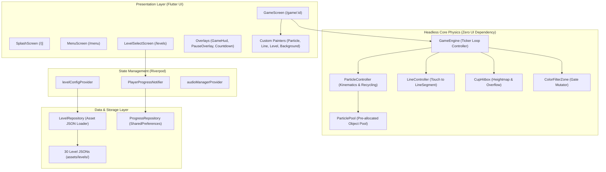

# Micin Micin

[](https://flutter.dev)
[](https://dart.dev)
[](file:///d:/kayzz/flutter/micin/micin_micin/test)
[](file:///d:/kayzz/flutter/micin/micin_micin/analysis_options.yaml)
[](#privacy--offline-guarantee)

> **Micin Micin** is a high-performance 2D granular physics puzzle game built with Flutter and Dart. It serves as an offline mobile tribute and clone of Bart Bonte's classic game *Sugar, Sugar*. Players draw chalk line barriers to route falling powdery particles ("micin" / sugar grains) into designated target cups across 30 progressively challenging stages.

---

## Table of Contents

- [Overview](#overview)
- [Key Features & Game Mechanics](#key-features--game-mechanics)
- [Architecture & Tech Stack](#architecture--tech-stack)
- [Repository Structure](#repository-structure)
- [Getting Started](#getting-started)
- [Testing & Quality Assurance](#testing--quality-assurance)
- [Privacy & Offline Guarantee](#privacy--offline-guarantee)
- [Documentation & Architectural References](#documentation--architectural-references)

---

## Overview

In *Micin Micin*, grains cascade from spouts at the top of the canvas. Players use touch gestures to draw smooth guide lines that direct particles into target receptacles. The game combines authentic physical simulation with tactile puzzle solving, featuring:

- **30 Handcrafted Stages** structured into 4 thematic acts (Basics, Optical Color Filters, Gravity Inversion, and Grand Challenges).
- **Single & Multi-Cup Targets** requiring precise division and routing of particle streams.
- **Color Filter Gates** that mutate passing particle colors to match cup requirements.
- **Gravity Inverters** that dynamically flip particle trajectory 180° across vertical axes.
- **Infinite Drawing Canvas** with real-time deflections and no artificial ink limits.

---

## Key Features & Game Mechanics

### 1. Granular Sand Piling Physics
- **1D Discrete Column Heightmap:** Target cups model authentic sugar accumulation across discrete $2.0\text{ px}$ bins with continuous cascade downhill rolling.
- **Angle of Repose ($\Delta H_{\max} = 1.4\text{ px} \approx 35^\circ$):** Falling grains naturally settle and cascade into conical mounds rather than artificial vertical pillars.
- **Overflow Spill Mechanics:** Once a cup is filled to capacity, excess grains smoothly tumble over the rims back into active free-fall to cascade into lower cups.
- **Selective Color Membrane:** Cups deflect non-matching particle colors away from the rim opening, requiring correct routing through filter gates.

### 2. Continuous Collision Detection (CCD)
- Line segment collision utilizes continuous swept raycasting and scalar Euclidean projections.
- Prevents particle tunneling through thin player-drawn strokes even at terminal velocities ($v_{\max} = 4.8\text{ px/frame}$).

### 3. Unified Virtual Resolution ($400 \times 700$)
- Native virtual coordinate space maintained by `VirtualCoordinateAdapter`.
- Touch inputs, physics calculations, and level definitions remain 100% deterministic and aspect-ratio independent across phones, tablets, and desktops via letterboxing/pillarboxing.

### 4. Chunky Arcade Visual Identity
- **Design Language:** Tactile 3D extruded button slabs, solid hard coin-drop shadows (`Offset(0, 4)`), and vibrant arcade palettes (`CartoonTokens`).
- **Zero-Allocation Hot Path:** Heavy live shader blurs are excluded from active 60/120 FPS physics loops to ensure zero-GC frame drops on mobile devices.
- **Diegetic HUD & Overlays:** In-game amber coin HUD dock, tactile countdown cup numerals, and pop-scale menu modals.

### 5. Hierarchical Audio Mixer & ASMR Feedback
- **Bus Hierarchy:** `MasterBus` $\leftarrow$ `[MusicBus, AmbienceBus, SfxBus, InteractionBus]` with dynamic logarithmic gain attenuation and headroom control (-16 LUFS).
- **Pentatonic Progress Pings:** Particle captures dynamically play soothing xylophone pings interpolated across pentatonic intervals (C5 to A5) with natural pitch micro-jitter.
- **Sidechain Ducking:** Automatic music attenuation (-10 dB) during victory moments and pause states.

---

## Architecture & Tech Stack

The application follows a **Clean Layered Architecture** separating the headless physics simulation from the presentation widgets.



### Core Libraries & Dependencies

| Package | Version | Purpose |
|---|---|---|
| `flutter_riverpod` | `^2.6.1` | Reactive state management for player progress, level configs, and audio bus gains |
| `flame` | `^1.38.2` | 2D game framework component architecture and rendering pipeline bridge |
| `go_router` | `^14.6.0` | Declarative URL routing across Splash, Menu, Level Select, and Game views |
| `audioplayers` | `^6.1.0` | Multi-source audio playback with hierarchical volume control |
| `shared_preferences` | `^2.3.2` | Local offline persistence for level progression |
| `google_fonts` | `^6.2.1` | Bundled offline typography (`Outfit` font family) |
| `mocktail` *(dev)* | `^1.0.4` | Null-safe mocking library for unit testing |
| `flutter_lints` *(dev)* | `^5.0.0` | Strict static analysis rules and linter standards |

---

## Repository Structure

```text
micin_micin/
├── assets/
│   ├── audio/              # BGM stems, chimes, pings, and filter sound effects
│   ├── fonts/              # Pre-bundled Outfit fonts (Regular, SemiBold, Bold)
│   ├── images/             # 2D icons, vessels, emitters, gates, and cartoon props
│   └── levels/             # 30 Level configuration JSONs (level_01.json .. level_30.json)
├── lib/
│   ├── audio/              # AudioManager and AudioBus hierarchical mixer models
│   ├── core/               # Global constants, extensions, theme (CartoonTokens), and GameState
│   ├── data/               # LevelRepository and ProgressRepository
│   ├── engine/             # Headless 2D physics simulation (Zero Flutter UI imports)
│   │   ├── collision/      # CupHitbox, LineSegment, SilhouetteColliderFactory
│   │   ├── color_filter/   # ColorFilterZone logic
│   │   ├── drawing/        # LineController, DrawnLine, VirtualCoordinateAdapter
│   │   ├── particle/       # ParticlePool, ParticleEmitter, ParticleController
│   │   └── game_engine.dart# Central ticker loop controller
│   ├── models/             # Immutable data models (LevelConfig, CupConfig, LevelVisualTheme)
│   ├── providers/          # Riverpod providers for progress, audio, and levels
│   ├── screens/            # Application screens (Splash, Menu, LevelSelect, Game)
│   │   ├── game/           # GameScreen, GameHud, and CustomPainters
│   │   ├── level_select/   # LevelSelectScreen and LevelButton
│   │   └── menu/           # MenuScreen and CreditsScreen
│   ├── widgets/            # Reusable UI components (CartoonButton, Overlays, Dialogs)
│   ├── app.dart            # MaterialApp.router and GoRouter configuration
│   └── main.dart           # Application entry point with ProviderScope setup
├── test/                   # Automated unit, widget, and integration test suite (190 passing)
├── tool/                   # Development utilities (check_coverage.dart, audio generator)
├── analysis_options.yaml   # Linter configuration (flutter_lints)
└── pubspec.yaml            # Project dependencies and asset definitions
```

---

## Getting Started

### Prerequisites

- [Flutter SDK](https://docs.flutter.dev/get-started/install) (version 3.19.0 or higher recommended)
- [Dart SDK](https://dart.dev/get-started) (version 3.12.2 or higher)
- Android Studio / VS Code with Flutter extension
- Android SDK (API Level 21+) or desktop build environment (Windows/macOS/Linux)

### Installation & Run

1. **Clone the repository:**
   ```bash
   git clone https://github.com/your-username/micin.git
   cd micin/micin_micin
   ```

2. **Install dependencies:**
   ```bash
   flutter pub get
   ```

3. **Run the game:**
   ```bash
   flutter run
   ```

4. **Build release Android APK:**
   ```bash
   flutter build apk --release
   ```

---

## Testing & Quality Assurance

The codebase enforces a **Two-Layer Testing Mandate**:
1. **Micro-Level:** Unit and widget tests per model, engine component, custom painter, and screen.
2. **Macro-Level:** End-to-end integration tests validating multi-frame particle routing, color mutating gates, and gravity toggle behavior.

### Running Tests

Execute the automated test suite:

```bash
# Run all unit, widget, and integration tests
flutter test

# Run tests with code coverage analysis
flutter test --coverage

# Evaluate coverage percentage against quality gates
dart run tool/check_coverage.dart
```

### Static Analysis

Validate code quality and linter conformance:

```bash
flutter analyze
```

> [!NOTE]
> All 190 automated tests currently pass with **100% green rate** and **0 analyzer issues**.

---

## Privacy & Offline Guarantee

- **100% Offline-First:** Requires no internet connection to play.
- **Zero Permissions:** `android.permission.INTERNET` is not included or requested in `AndroidManifest.xml`.
- **Zero Telemetry:** No third-party trackers, analytics, or external logging SDKs.
- **Local Persistence Only:** Level progression is stored purely on the local device via `SharedPreferences`.

---

## Documentation & Architectural References

For in-depth architecture decisions, engineering standards, and SDLC specifications, consult:

- [docs/ARCHITECTURE.md](file:///d:/kayzz/flutter/micin/docs/ARCHITECTURE.md) — Canonical living architecture map and coordinate space contract.
- [instructions/memory.instructions.md](file:///d:/kayzz/flutter/micin/instructions/memory.instructions.md) — Persistent project memory log and technical checkpoints.
- [docs/adr/0001-geometric-collision-detection.md](file:///d:/kayzz/flutter/micin/docs/adr/0001-geometric-collision-detection.md) — Continuous collision detection design.
- [docs/adr/0002-unified-virtual-resolution.md](file:///d:/kayzz/flutter/micin/docs/adr/0002-unified-virtual-resolution.md) — $400 \times 700$ virtual resolution pipeline.
- [docs/adr/0003-discrete-column-heightmap-sand-piling.md](file:///d:/kayzz/flutter/micin/docs/adr/0003-discrete-column-heightmap-sand-piling.md) — Granular sand piling and slope relaxation.
