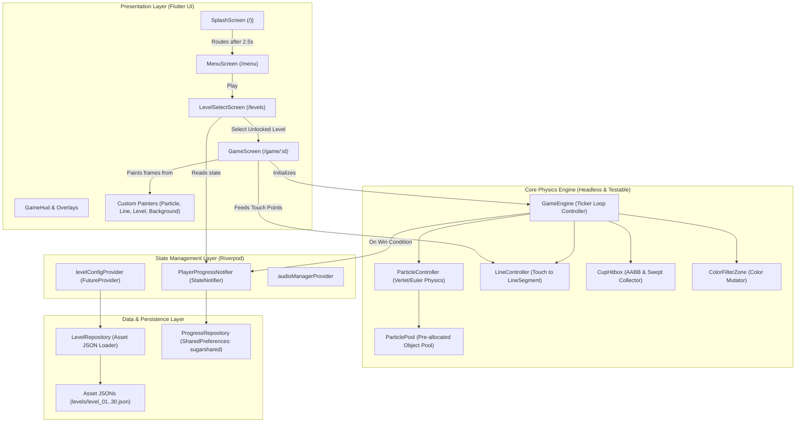

<!-- markdownlint-disable -->

# Architecture Documentation


This document serves as the canonical architectural map of the `micin` repository. It outlines the design patterns, technical stack, directory structure, module constraints, and data flow to assist developers and AI agents in safely maintaining, extending, and refactoring the codebase.

---

## 1. Project Overview

**Micin Micin** is a high-performance 2D physics puzzle game built with Flutter and Dart, serving as an offline mobile tribute and clone of Bart Bonte's classic Flash web game *Sugar, Sugar*. 

The objective of the game is to guide falling granular particles ("micin" / sugar grains) emitted from spouts into corresponding target cups by drawing line barriers on the screen. The game features 30 progressively challenging stages with mechanics including single and multi-cup receptacles, optical color filter gates (which mutate particle color upon passing through), and vertical gravity inversions.

---

## 2. High-Level Architecture & Tech Stack

- **Primary Language:** Dart 3.12+
- **Application Framework:** Flutter (Android mobile focus, multi-platform capable)
- **Architectural Pattern:** Clean Layered Architecture (Headless Physics Engine → Flame Rendering Bridge → Flutter UI/Overlays).
- **State Management:** Riverpod 2.6 (`flutter_riverpod`, `AsyncNotifier`, `AsyncValue`, `FutureProvider.family`)
- **Navigation:** GoRouter 14.6 (Declarative URL-based routing)
- **Game Engine / Rendering:** Flame 1.38.2 (`flame`) — replaces raw `CustomPainter + Ticker` stack.
  - `MicinGame` (`FlameGame`) bridges `GameEngine` physics to Flame's `GameWidget` renderer.
  - All game components (`BackgroundFlameComponent`, `SilhouetteFlameComponent`, `LevelGeometryFlameComponent`, `ParticleSystemFlameComponent`, `LineDrawingFlameComponent`) are pure Flame `Component`s at declared priorities.
  - Touch input routed via `DragCallbacks` mixin; `canvasStartPosition` mapped to virtual space via `VirtualCoordinateAdapter`.
- **Virtual Resolution Pipeline:** Unified $400 \times 700$ virtual coordinate space (`VirtualCoordinateAdapter`). Letterboxing/pillarboxing guarantees 100% deterministic physics across any device aspect ratio.
- **Granular Physics & Sand Piling Engine:** Calibrated powdery sand physics ($r = 1.1\text{ virtual px}$, $g = 0.14\text{ px/frame}^2$, $v_{\max} = 4.8\text{ px/frame}$). Target cups feature a 1D Discrete Column Heightmap with Angle of Repose slope relaxation and Overflow Spill mechanics.
- **Arcade Visual Identity ("Chunky Arcade" Design Language):**
  - **Design Tokens (`CartoonTokens` in `core/theme.dart`):** Hard drop-shadow 3D buttons, no glassmorphism, no live blur on hot paths.
  - **Main Menu (`MenuScreen`):** Diegetic chalk/arcade aesthetic — stacked `micin` logotype, `draw · guide · fill` tagline, falling sugar grain rain (`AnimatedBuilder`), chunky capsule buttons with hard coin-shadow depth.
  - **In-Game HUD (`GameHud`):** Amber coin badge (custom-painted `_CoinPainter`), circular icon buttons with solid hard-shadow depth, pulsing GRAVITY pill with cyan glow halo.
  - **Pause Overlay (`PauseOverlay`):** Full-bleed `BackdropFilter` blur, cartoon panel center-piece with floating action buttons (RESUME, ULANGI, KEMBALI) using `ZenGlyphButton` with hard shadow.
  - **Countdown Overlay (`CountdownOverlay`):** Pop-scale `TweenSequence` animation, amber/green gradient pill badge.
  - **Level Select (`LevelSelectScreen`):** Chunky arcade design — solid drop-shadow act cards (colored top accent stripe, BABAK label badge, progress bar), roman-numeral-only act tab navigator with hard shadow on active tab, solid amber coin progress badge in header. Zero `GlassContainer`. `LevelButton` grid with 3D bevel unlock/completed/locked states.
- **Rendering Paradigm:** Flame `GameWidget` (priority-ordered `Component` tree) as the game canvas. Flutter `Overlay` builders for HUD and pause overlays composited on top via `GameWidget.overlayBuilderMap`.
- **Persistence:** SharedPreferences (`sugarshared` key, zero backend dependency)
- **Audio:** `audioplayers` 6.1 with Hierarchical Audio Mixer (`AudioBus` tree: `MasterBus ← [MusicBus, AmbienceBus, SfxBus, InteractionBus]`), sidechain ducking, stem layering, and pentatonic pitch-interpolated grain capture pings.
- **Typography:** Google Fonts (`Outfit` font family, pre-bundled offline)

---

## 3. Data Flow & Layer Dependencies



### Flow Lifecycle Description:
1. **App Bootstrap (`lib/main.dart`):** Ensures Flutter bindings, disables online runtime Google Fonts fetching (offline asset only), and boots `MicinApp` wrapped in `ProviderScope`.
2. **Splash & Preload (`lib/screens/splash/`):** Preloads `AudioManager` and transitions to `/menu` after 2.5 seconds.
3. **Menu & Stage Selection:** `MenuScreen` lets users view `CreditsScreen` or enter `LevelSelectScreen`. `LevelSelectScreen` reads `playerProgressProvider` to render unlocked vs locked stages.
4. **Game Loop:**
   - `GameScreen` loads `LevelConfig` (from router extra or `LevelRepository.loadLevel(id)`).
   - `GameEngine` starts Flutter's `Ticker`. On every vsync tick (~60fps), `ParticleController.update()` runs:
     - Emitters release powdery particles from `ParticlePool` with velocity/position jitter and crystalline opacity.
     - Soft gravity ($g = 0.14$) is integrated and clamped to $kMaxSpeed = 4.8$.
     - Filter zones mutate particle colors.
     - Player-drawn line segments deflect particle velocities.
     - Target cups:
       - Selective Membrane deflects non-matching particles off the aperture.
       - Matching particles settle onto the 1D Discrete Column Heightmap, cascade rolling downhill along the Angle of Repose ($\Delta H_{\max} = 1.4\text{ px}$).
       - Excess particles roll over cup rims via Overflow Spill into active free-fall.
       - Countdown decrements to 0, turning gold `#FFD54F`.
   - `GameScreen` calls `setState()`, and `RepaintBoundary` painters batch-draw particles, resting sand mounds, lines, and cup countdowns.
5. **Completion & Persistence:** Once `isLevelComplete` triggers (when all cups reach `remaining == 0`), `_hasHandledCompletion` guard prevents multiple calls, triggers `SoundType.levelComplete`, updates `ProgressRepository`, unlocks level $N+1$, and displays `LevelCompleteDialog`.

---

## 4. Dependencies & External Services

| Dependency | Version | Purpose |
|---|---|---|
| `flutter_riverpod` | `^2.6.1` | Reactive state management across game progress, audio, and configuration. |
| `audioplayers` | `^6.1.0` | Background music looping and sound effects playback. |
| `shared_preferences` | `^2.3.2` | Local device persistence of completed/unlocked levels under key `sugarshared`. |
| `go_router` | `^14.6.0` | Declarative routing between Splash, Menu, Level Select, Credits, and Game screens. |
| `google_fonts` | `^6.2.1` | Clean typography (`Outfit`) bundled offline in asset manifest. |
| `mocktail` (dev) | `^1.0.4` | Mocking `AudioPlayer` and platform dependencies in headless unit tests. |
| `flutter_lints` (dev) | `^5.0.0` | Strict static analysis and lint rule enforcement. |

---

## 5. Directory Tree Map

```text
d:/kayzz/flutter/micin/
├── .agents/                        # SDLC guidelines, agent roles, and standardized skills
├── docs/                           # Architectural maps, ADRs, and verification audits
│   ├── adr/                        # Architecture Decision Records
│   │   ├── 0001-geometric-collision-detection.md
│   │   ├── 0002-unified-virtual-resolution.md
│   │   └── 0003-discrete-column-heightmap-sand-piling.md
│   ├── audit/                      # Clarification and QA audit reports
│   ├── design/                     # Art direction and design system specifications
│   │   └── art-direction-brief.md  # Canonical Art Direction Brief & Style Bible (Chunky Arcade)
│   ├── ARCHITECTURE.md             # This document (Canonical Architecture Map)
│   └── tdd/                        # Test-Driven Development specifications
├── plan/                           # SDLC Implementation Plans
│   ├── plan-feature-micin-game-v1.0.md
│   ├── plan-architecture-unified-virtual-resolution-v1.0.md
│   └── plan-architecture-sand-piling-physics-v1.0.md
└── micin_micin/                    # Core Flutter Application Package
    ├── assets/
    │   ├── asset-manifest.json     # Canonical 2D visual asset manifest (schema v1)
    │   ├── audio/                  # BGM, vertical stems & SFX (bgm.mp3, chimes_loop.wav, particle_ping.wav, filter_pass.wav)
    │   ├── fonts/                  # Bundled offline Outfit font weights (Regular, SemiBold, Bold)
    │   ├── images/                 # 2D visual assets & SVG icons (icons/, vessels/, emitters/, gates/)
    │   └── levels/                 # 30 Level definition JSONs (level_01.json .. level_30.json)
    ├── lib/
    │   ├── audio/                  # Central AudioManager & AudioBus hierarchical mixer models
    │   ├── core/                   # Global constants, extensions, theme (CartoonTokens - Chunky Arcade tokens), and GameState enum
    │   ├── data/                   # Level and Progress repositories
    │   ├── engine/                 # Headless physics, particle simulation, and collision engine
    │   │   ├── collision/          # CupHitbox, LineSegment, and SilhouetteColliderFactory collision logic
    │   │   ├── color_filter/       # ColorFilterZone gate mechanics
    │   │   ├── drawing/            # DrawnLine, LineController, VirtualCoordinateAdapter
    │   │   ├── particle/           # ParticlePool, ParticleEmitter, ParticleController
    │   │   └── game_engine.dart    # Central ticker-driven game loop orchestrator
    │   ├── models/                 # Immutable domain data models (LevelConfig, CupConfig, LevelVisualTheme, SilhouettePropConfig)
    │   ├── providers/              # Riverpod StateNotifier, Future, and AudioBus gain providers
    │   ├── screens/                # UI screens (Splash, Menu, LevelSelect, Game)
    │   │   ├── game/               # GameScreen, GameHud, and CustomPainters (Particle, Line, Level, Background, Silhouette)
    │   │   ├── level_select/       # LevelSelectScreen and LevelButton tile
    │   │   └── menu/               # MenuScreen and CreditsScreen
    │   ├── widgets/                # Reusable UI widgets (CartoonButton, CartoonIconButton, LevelCompleteDialog, CountdownOverlay, PauseOverlay)
    │   ├── app.dart                # MaterialApp.router and GoRouter route declarations
    │   └── main.dart               # Main entry point with ProviderScope and font initialization
    ├── test/                       # Comprehensive automated test suite (190 passing tests, 0 failures)
    │   ├── audio/                  # AudioManager and AudioBus hierarchical mixer unit tests
    │   ├── data/                   # Repository serialization and asset loading tests
    │   ├── engine/                 # Physics, collision, silhouette props, and pool unit tests
    │   ├── integration/            # Color filter, sand piling, and gravity inversion integration tests
    │   ├── models/                 # Data model JSON round-trip, theme, and validation tests
    │   ├── screens/                # Widget tests for GameScreen, Navigation, Painters, and Dialogs
    │   ├── widgets/                # Widget tests for CartoonButton, CartoonIconButton, and overlays
    │   └── widget_test.dart        # Root app widget test
    ├── tool/                       # Helper scripts (check_coverage.dart, generate_zen_audio.dart)
    └── pubspec.yaml                # Package manifest and asset registrations
```

---

## 6. Directory Purposes & Responsibilities

| Directory / File | Primary Purpose | Contains | Rules / Constraints |
|---|---|---|---|
| `micin_micin/lib/audio/` | Hierarchical Audio Mixer & playback | `AudioManager`, `AudioBus` | Hierarchical logarithmic gain math, headroom control (-16 LUFS), sidechain ducking, vertical stem layering, and low-latency interaction pool. |
| `micin_micin/lib/engine/` | Headless 2D physics & game mechanics | Particle controller, pool, emitters, line collision, silhouette colliders, cup hitbox | **Zero UI dependency**. Must remain 100% testable in headless Dart unit tests without Flutter UI. |
| `micin_micin/lib/models/` | Domain entity models | `SugarParticle`, `LevelConfig`, `CupConfig`, `LevelVisualTheme`, `SilhouettePropConfig`, `PlayerProgress` | Pure immutable models. Must support bidirectional JSON serialization. |
| `micin_micin/lib/data/` | Asset & persistence access | `LevelRepository`, `ProgressRepository` | Handles local I/O. `ProgressRepository` must NOT implement `bestScore` (deferred to v1.1 per CON-004). |
| `micin_micin/lib/providers/` | Dependency injection & state | Riverpod providers for audio, progress, and configs | Exposes reactive state to UI screens. |
| `micin_micin/lib/screens/game/painters/` | High-performance rendering | `ParticlePainter`, `LinePainter`, `LevelPainter`, `BackgroundPainter`, `SilhouettePainter` | Batch render with `drawRect` / `drawPoints` where applicable. No object allocations inside `paint()`. |
| `micin_micin/lib/screens/` | Full-screen views | Splash, Menu, Level Select, Game, Credits | Interacts with engine and navigation routes via GoRouter. |
| `micin_micin/lib/widgets/` | Chunky 3D arcade buttons, panels, and modal dialogs | `CartoonButton`, `CartoonIconButton`, `LevelCompleteDialog`, `PauseOverlay`, `CountdownOverlay` | Reusable Chunky Arcade components and overlays displayed across game or selection screens. |
| `micin_micin/assets/levels/` | Game level blueprints | `level_01.json` through `level_30.json` | Must strictly match `LevelConfig` schema. Total sugar quota equals 150% supply formula (150 * N_cups), minimum 40px cup apertures, and bilateral geometric symmetry. |
| `micin_micin/test/` | Automated test suite | Unit, widget, and integration test files | 100% test pass rate required. Minimum 70% line coverage on `lib/engine/` and `lib/models/`. |

---

## 7. Key Configuration Files

- `micin_micin/pubspec.yaml`: Declares dependencies, assets (`assets/fonts/`, `assets/levels/`, `assets/audio/`), and font families.
- `micin_micin/analysis_options.yaml`: Configures strict linting rules based on `package:flutter_lints/flutter.yaml`.
- `micin_micin/android/gradle.properties`: Sets JVM arguments and disables buggy Kotlin incremental compilation (`kotlin.incremental=false`) to ensure deterministic Android builds on Windows cross-drive setups.

---

## 8. Entry Points

- **Application Initialization:** `micin_micin/lib/main.dart` -> `runApp(const ProviderScope(child: MicinApp()))`.
- **Navigation & Routing:** `micin_micin/lib/app.dart` -> `appRouter` declaring routes `/`, `/menu`, `/levels`, `/credits`, `/game/:id`.
- **Game Engine Loop:** `micin_micin/lib/engine/game_engine.dart` -> `start(TickerProvider vsync)` attached inside `_GameScreenState.initState()`.

---

## 9. Environment & Deployment

- **Target Platforms:** Android (minSdkVersion 21, targetSdkVersion 34), with cross-platform support for Desktop (Windows) and Web.
- **Offline Guarantee:** Game is completely offline. No network permissions required or requested in `AndroidManifest.xml`.
- **Build Commands:**
  - Debug Run: `flutter run`
  - Release Android APK: `flutter build apk --release`

---

## 10. Testing Strategy

- **Two-Layer Mandate:**
  1. **Micro-Level:** Unit and widget tests per model, engine component, painter, and screen.
  2. **Macro-Level:** Integration test suite (`test/integration/`) verifying full multi-frame particle routing, color mutating gates, and gravity toggle behavior.
- **Current Test Metrics:** 190 tests passing across 28 test files with **100% pass rate**, 0 failures, and 0 analyzer issues (`flutter test`, `flutter analyze`).
- **Execution Commands:**
  - Run all tests: `flutter test`
  - Run with coverage: `flutter test --coverage`
  - Evaluate coverage percentage: `dart run tool/check_coverage.dart`

---

## 11. AI Agent Boundaries

- **Surgical Edit Rule:** Always make targeted edits; avoid replacing entire files unless creating new files from scratch.
- **Floor-Guard Anti-Cheat:** Never insert `// ignore:` comments or skip test assertions (`.skip`, `xit`) to artificially pass linters.
- **Coordinate Space Contract:** When addressing physics, input handling, and rendering, all internal calculations MUST remain in native virtual coordinates ($400 \times 700$). Screen coordinates from gesture listeners must pass through `VirtualCoordinateAdapter.screenToVirtual()`, and CustomPainters must render directly in virtual points within the letterboxed canvas root transform. All level JSON assets are maintained in native integer coordinates ($400 \times 700$).
