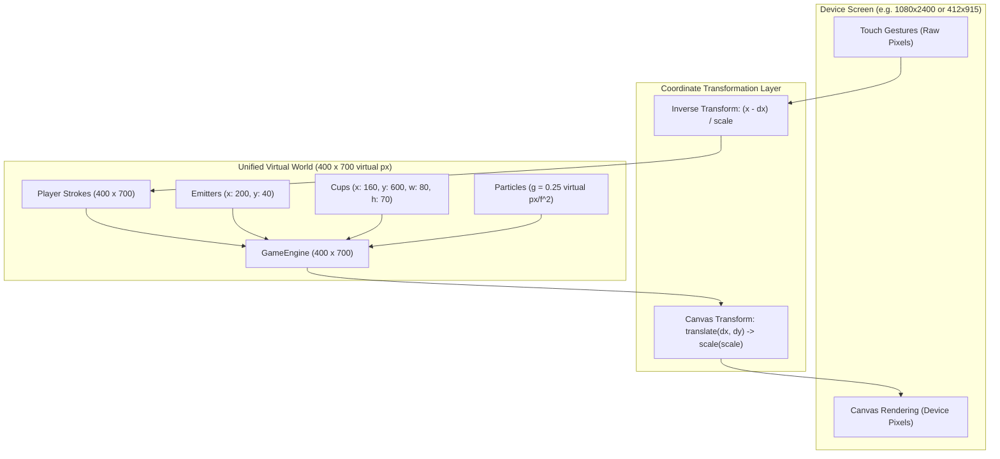

# Project Discovery Summary: Unified Virtual Resolution & Natural Physics Calibration

## 1. Project Overview

**Micin Micin** is a high-performance 2D physics puzzle game written in Flutter/Dart, replicating the mechanics of Bart Bonte's classic game *Sugar, Sugar*. During gameplay testing of the newly completed Phase 1–5 implementation, two critical physical discrepancies were observed:

1. **Particle Teleportation / Frame Skipping:** Sugar particles ("micin") appear to fall in only 2 to 3 discrete visual steps before disappearing into the cup (spanning the screen in ~50ms), creating an unnatural "teleportation" illusion rather than a smooth, silky stream of granular powder.
2. **Stroke Barrier Impenetrability Failure:** When a player draws a line directly across the mouth of a cup, particles pass right through the drawn barrier without bouncing or deflecting, and the cup counter continues incrementing as if no line was present.

The purpose of this Discovery Draft is to perform a rigorous architectural and mathematical root cause analysis, evaluate whether a heavy physics engine like Flame/Forge2D is warranted, and specify the architecture for a **Unified Virtual Resolution (400×700 virtual pixels)** and **Natural Gravity Calibration**.

---

## 2. Technology Stack & Infrastructure

As documented in [docs/ARCHITECTURE.md](file:///d:/kayzz/flutter/micin/docs/ARCHITECTURE.md):

- **Core Framework & Language:** Flutter 3.x / Dart 3.12+ (Mobile/Desktop/Web)
- **Physics Architecture:** Pure headless Dart physics engine (`micin_micin/lib/engine/game_engine.dart`), completely decoupled from Flutter widgets.
- **Rendering Pipeline:** `CustomPainter` (`micin_micin/lib/screens/game/painters/`) synchronized with Flutter's `Ticker` loop (`singleTickerProvider`), using batch point rendering (`PointMode.points`) for particle performance.
- **State Management:** Riverpod 2.6 (`StateNotifierProvider`, `PlayerProgressNotifier`, `levelConfigProvider`).
- **Mathematical Collision Model:** Deterministic continuous raycasting and line segment geometry (`Point`, `LineSegment.resolveCollision`) with normal vector reflection.

---

## 3. Current Architecture Assessment

### 3.1 Root Cause Analysis

#### Root Cause 1: The Dual Coordinate Space Disconnect (Stroke Collision Failure)

An architectural audit of the interaction between `GameScreen`, `GameEngine`, and `LevelPainter` revealed two completely incompatible coordinate systems running simultaneously:

- **World Space A (Normalized Physics `[0.0 .. 1.0]`):**
  - Emitters are configured at normalized coordinates: e.g., `(x: 0.5, y: 0.05)`.
  - Cups are placed at normalized coordinates: e.g., `(x: 0.45, y: 0.85)` with width `0.10` and height `0.08`.
  - Particles are spawned and integrated strictly in normalized space: `p.position = (0.5, 0.05)`.
  - Particle collision radius: `p.radius = 0.006`.
- **World Space B (Device Screen Logical Pixels):**
  - In `micin_micin/lib/screens/game/game_screen.dart`, user touch gestures are captured via `GestureDetector`:
    ```dart
    onPanUpdate: (details) {
      ref.read(gameEngineProvider.notifier).addPlayerStrokePoint(details.localPosition);
    }
    ```
  - `details.localPosition` yields device screen logical pixels: e.g., on a 412×915 device, drawing a barrier near the cup results in points like `(x: 206.0, y: 777.0)`.
- **The Collision Failure Mechanism:**
  When `GameEngine.update(dt)` iterates over each particle and calls `LineSegment.resolveCollision(particle)`:
  - Particle position: `(0.5, 0.85)`
  - Line segment: `from: (200.0, 770.0)` to `to: (220.0, 770.0)`
  - The geometric distance formula calculates:
    $$d = \sqrt{(200.0 - 0.5)^2 + (770.0 - 0.85)^2} \approx 794.7 \text{ units}$$
  - Collision condition: `distance <= particle.radius + strokeThickness / 2` ($\approx 0.006 + 1.5 = 1.506$).
  - Because $794.7 \gg 1.506$, **the physics engine never registers contact**. The particles fall straight through to the cup.
- **Why It Looked Like It Should Work (The Painter Illusion):**
  In `LevelPainter`, the custom painter scaled the normalized cups and particles by `size.width` and `size.height`, but rendered the player strokes at raw pixel coordinates. Visually, both appeared on the same screen area, masking the internal coordinate mismatch.

---

#### Root Cause 2: The Gravity Scaling Paradox (The 3-Frame Drop)

In the original Flash game *Sugar, Sugar* by Bart Bonte:
- The game canvas was a fixed $600 \times 400$ or $600 \times 500$ pixel window.
- The acceleration of gravity was configured to $g \approx 0.2 \text{ px/frame}^2$.
- For a particle to fall $h = 500 \text{ px}$ from top to bottom:
  $$h = \frac{1}{2} g t^2 \implies t = \sqrt{\frac{2h}{g}} = \sqrt{\frac{2 \times 500}{0.2}} = \sqrt{5000} \approx 70.7 \text{ frames}$$
- At 60 FPS, $70.7 \text{ frames} \approx 1.18 \text{ seconds}$. This produced a dense, tranquil, silky cascade of granular sugar grains.

In *Micin Micin*:
- The coordinate height was normalized to $1.0$.
- However, `kGravity` in `lib/core/constants.dart` was defined as `0.2` (carried over directly from pixel-space formulas):
  $$\Delta v_y = 0.2 \times (dt \times 60) = 0.2 \text{ units per frame}$$
- Free-fall simulation step-by-step:
  - **Frame 0 (Spawn):** $y_0 = 0.05, v_y = 0.0$
  - **Frame 1 (16.6ms):** $v_y = 0.20, y_1 = 0.05 + 0.20 = 0.25$ (already 25% down the screen)
  - **Frame 2 (33.3ms):** $v_y = 0.40, y_2 = 0.25 + 0.40 = 0.65$ (65% down the screen)
  - **Frame 3 (50.0ms):** $v_y = 0.60, y_3 = 0.65 + 0.60 = 1.25$ (exits screen / enters cup)
- The entire screen traversal occurred in **exactly 3 frames (50 milliseconds)**.
- Human eye perception: The user only saw 2 flickers (Frame 1 at $y=0.25$ and Frame 2 at $y=0.65$) before the particle vanished into the cup counter.

---

### 3.2 Evaluation of Flame & Forge2D

The user raised the question: *“Untuk texture physics, kalau pakai Flame apakah bisa?”*

**Senior Staff Engineer Assessment: Strongly Advise Against Flame / Forge2D for this use case.**

| Architectural Criteria | CustomPainter + Headless Engine (Current) | Flame + Forge2D (Box2D) |
|---|---|---|
| **Particle Volume** | Easily handles 500–1000 dynamic particles at steady 60 FPS | Severe frame drops above 150–200 dynamic bodies due to $O(N^2)$ contact solvers |
| **Collision Type** | Point-to-segment continuous raycast (O(N·M)) | Iterative polygon-to-circle manifold constraint solver |
| **Memory Footprint** | Extremely lightweight (~40KB for particle pool) | Heavy heap allocations per `BodyDef`, `FixtureDef`, `Contact` |
| **Authenticity** | Exact 1:1 reproduction of Bart Bonte's original Flash code | Inauthentic rigid-body bouncy ball physics |
| **Multiplatform Support** | Zero native C++ compilation bindings, runs everywhere | JNI / FFI overhead on some targets |

**Conclusion:** The original *Sugar, Sugar* was **never** a rigid-body physics simulation. It is a granular particle automator with continuous vector deflection. Integrating Flame/Forge2D would introduce massive architectural bloat and ruin the granular sand fluidity.

---

### 3.3 Proposed Architectural Refactoring: Unified Virtual Resolution (400×700)

To resolve both root causes permanently without breaking screen adaptivity, the game must transition from fractional normalized coordinates `[0..1]` to a **Unified Virtual Resolution of $400 \times 700$ virtual pixels**.



#### Key Technical Specifications:
1. **Virtual Aspect Ratio:** $400 \times 700$ (Aspect ratio $\approx 9:15.75$, fitting modern tall mobile screens while letterboxing safely on tablets/desktop).
2. **Aspect Ratio Fitting Strategy:** `BoxFit.contain` with centered letterboxing:
   - Scale factor: $S = \min(\text{deviceWidth} / 400.0, \, \text{deviceHeight} / 700.0)$
   - Offsets: $dx = (\text{deviceWidth} - 400.0 \times S) / 2$, $dy = (\text{deviceHeight} - 700.0 \times S) / 2$
3. **Touch Input Mapping:**
   $$x_{\text{virtual}} = \frac{x_{\text{device}} - dx}{S}, \quad y_{\text{virtual}} = \frac{y_{\text{device}} - dy}{S}$$
4. **Natural Gravity Recalibration:**
   - Virtual Canvas Height: $H = 700 \text{ virtual px}$
   - Calibrated Gravity: $g = 0.25 \text{ virtual px/frame}^2$ ($900 \text{ virtual px/s}^2$)
   - Terminal Velocity: $v_{\max} = 8.0 \text{ virtual px/frame}$
   - Free fall duration from $y=40$ to $y=600$ ($h = 560 \text{ virtual px}$):
     $$t = \sqrt{\frac{2 \times 560}{0.25}} = \sqrt{4480} \approx 67 \text{ frames} \approx 1.11 \text{ seconds}$$
   - **Result:** Particles flow in a dense, continuous stream, rendering 67 micro-steps across the screen rather than 3 jarring jumps.

---

## ⚙️ Operational Workflow

### Workflow A: Player Stroke Registration & Virtual Collision
1. **Touch Event:** User drags finger across the screen. `GestureDetector.onPanUpdate` triggers with `details.localPosition`.
2. **Coordinate Normalization to Virtual Space:**
   `VirtualCoordAdapter.screenToVirtual(localPosition, screenSize)` converts device pixels to $(400 \times 700)$ space.
3. **Segment Creation:** The virtual point is appended to the active stroke. A `LineSegment(p1, p2, thickness: 4.0)` is constructed entirely in $(400 \times 700)$ space.
4. **Collision Evaluation:**
   `LineSegment.resolveCollision(particle)` compares particle position $(x_v, y_v)$ against the segment. When distance $\le r_{\text{particle}} + \text{thickness}/2$ (e.g., $2.5 + 2.0 = 4.5\text{ virtual px}$):
   - Particle velocity is reflected: $\vec{v}' = (\vec{v} - 2(\vec{v} \cdot \hat{n})\hat{n}) \times e$
   - Particle position is projected out of the segment boundary to prevent penetration tunneling.
   - If drawn across a cup mouth, particles bounce off and are prevented from reaching the cup collection sensor.

### Workflow B: Frame Update & Render Pipeline
1. **Tick Integration:** Flutter `Ticker` calls `GameEngine.update(dt)`.
2. **Euler Integration:** For each active particle in $(400 \times 700)$:
   $$v_y \leftarrow \min(v_y + g, v_{\max}), \quad x \leftarrow x + v_x, \quad y \leftarrow y + v_y$$
3. **Canvas Transformation:**
   In `GameScreen` / `LevelPainter`:
   ```dart
   canvas.save();
   canvas.translate(dx, dy);
   canvas.scale(S);
   // Everything drawn here is expressed in native 400x700 coordinates
   levelPainter.paint(canvas, const Size(400, 700));
   particlePainter.paint(canvas, const Size(400, 700));
   linePainter.paint(canvas, const Size(400, 700));
   canvas.restore();
   ```
4. **Letterbox Borders:** If device aspect ratio deviates from $400:700$, dark letterbox bars are rendered seamlessly matching the game's dark charcoal aesthetic.

---

## 5. Handoff Notes for Product Manager (/sdlc-draft-prd)

Before authoring the formal PRD or Specification for this physics overhaul, the Product Manager and Architect must incorporate the following requirements:

1. **Coordinate System Standard:**
   - Abandon fractional `[0.0 .. 1.0]` coordinates across all models (`LevelConfig`, `EmitterConfig`, `CupConfig`, `ColorFilterConfig`).
   - Standardize all 30 game levels to the $400 \times 700$ integer virtual grid.
2. **Physics Acceptance Criteria:**
   - **Fall Duration:** Particles dropped from $y=40$ without obstacles must take between $60$ and $75$ frames ($1.0\text{s} - 1.25\text{s}$) to reach the bottom ($y=650$).
   - **Barrier Seal:** Drawing a continuous line across any cup mouth must result in $0\%$ particle entry into the cup as long as the barrier is unbroken.
   - **Slide Behavior:** Particles resting on a sloped line ($> 20^\circ$) must slide smoothly along the line tangent vector rather than sticking or jittering.
3. **Backward Compatibility & Testing:**
   - Update `LevelProgressRepository` and level asset JSON loaders to support $400 \times 700$ definitions.
   - Re-baseline the 81 unit tests to use virtual pixel distances and verify 100% test pass rate with zero analyzer warnings.
4. **Suggested Next Phase Command:**
   Direct the user to invoke `/sdlc-draft-prd` or bypass directly to `/sdlc-define-specs` (since this is a pure technical refactoring with deterministic mathematical requirements).
