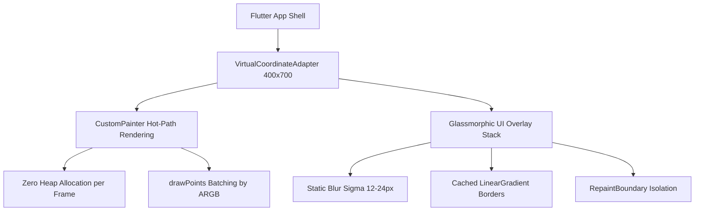

# Project Discovery Draft: Modern Minimalist & Glassmorphism UI Overhaul

> [!WARNING]
> **ARCHIVED & SUPERSEDED BY CHUNKY ARCADE**:
> This document details a historical visual iteration (Glassmorphism) that has been superseded by the canonical **Chunky Arcade** visual identity (`CartoonTokens`, 3D extruded slabs, solid drop shadows, and arcade coin HUD). Refer to [docs/design/art-direction-brief.md](file:///d:/kayzz/flutter/micin/docs/design/art-direction-brief.md), [docs/ARCHITECTURE.md](file:///d:/kayzz/flutter/micin/docs/ARCHITECTURE.md), and [CONTEXT.md](file:///d:/kayzz/flutter/micin/CONTEXT.md) for the active system standards.

## 1. Executive Summary & Intent

This discovery draft documents the architectural exploration and design strategy for overhauling the entire user interface of **Micin Micin** (Flutter 2D Physics Sugar Sugar Clone). 

Following the user directive and consultation through `ask_question`, the visual direction has transitioned from a rustic chalkboard/zen basalt stone aesthetic to a cutting-edge **Modern Minimalist & Glassmorphism** system.

### Scope of the Overhaul:
1. **Visual Redesign & Neo-Glass Palette:** Frosted glass panels, translucent specular gradient borders, luminous neon mineral colors (Cyan, Rose, Gold, Mint), and dark obsidian backgrounds.
2. **Layout & Ergonomics (Game UI/UX):** Streamlining the Main Menu, Bento Grid Stage Selector, In-Game Diegetic HUD, and modal overlays into clean, decoupled, responsive layouts.
3. **Tactile Feedback & Polish (Game Feel):** Incorporating spring-based button pops (`Curves.easeOutBack`), quick squash-and-stretch on touch, decaying trauma screen shake, and smooth cross-dissolve transitions.
4. **Game Design Document (GDD):** Codifying full UI/UX specifications under Chapter 7 (Interface) and Chapter 10 (Game Art) per the `openagenticgame-gdd` standard, illustrated with Mermaid architecture diagrams.

---

## 2. Architectural Constraints & Performance Budget

### Critical Non-Negotiables:
1. **Unified Virtual Resolution ($400 \times 700$):** All UI elements, dialogs, and painters must remain anchored to the letterboxed $400 \times 700$ virtual coordinate space (`VirtualCoordinateAdapter`).
2. **Zero-GC Hot Path:** `BackdropFilter` and glass decorations must be isolated behind `RepaintBoundary` widgets to avoid triggering CPU re-rasterization during the 60/120 FPS physics simulation.
3. **Infinite Stroke Capacity Invariant:** As established in Bart Bonte's canonical rules, no "ink gauge" or stroke limit may be introduced; players have infinite line capacity.
4. **Test Suite Integrity:** The existing automated test suite (157 unit, widget, and integration tests) must maintain 100% pass rate.

---

## 3. Technology Mapping & Artifact Reference

| Domain | File / Module Reference | Modern Glassmorphic Enhancement |
|---|---|---|
| **GDD Specification** | [GDD-modern-glassmorphism-ui-overhaul.md](file:///d:/kayzz/flutter/micin/docs/gdd/GDD-modern-glassmorphism-ui-overhaul.md) | Canonical Chapters 7 & 10 with 6 Mermaid diagrams |
| **Theme & Tokens** | `micin_micin/lib/core/theme.dart` | Introduce `GlassTokens` with obsidian base & refractive neon accents |
| **Main Menu** | `micin_micin/lib/screens/menu/menu_screen.dart` | Frosted glass action pills, diegetic glass nozzle, interactive sandbox |
| **Stage Selector** | `micin_micin/lib/screens/level_select/level_select_screen.dart` | 4-Act Glass Bento Grid with featured milestone cards & micro-shake |
| **In-Game HUD** | `micin_micin/lib/screens/game/game_hud.dart` | Borderless floating glass glyphs, chamber tag, glowing gravity pill |
| **Overlays** | `micin_micin/lib/widgets/pause_overlay.dart`, `level_complete_dialog.dart` | Full-bleed blur (sigma 24.0), floating breathing glass actions, golden radial bloom |

---

## 4. Next Steps in the SDLC Workflow

In accordance with `AGENTS.md` and the SDLC framework:
1. **Phase 0 (Discovery):** Completed with this Draft and the comprehensive GDD specification.
2. **Phase 1 (Technical Specification):** Invoke `/sdlc-define-specs` to generate machine-readable implementation specifications in `spec/` detailing widget schemas, theme tokens, and animation controllers.
3. **Phase 2 (Implementation Plan):** Invoke `/sdlc-plan-tasks` to generate a Tracer Bullet task breakdown in `plan/`.
4. **Phase 3 (Execution):** Invoke `/sdlc-write-code` to execute the Flutter code changes iteratively with micro-testing.
