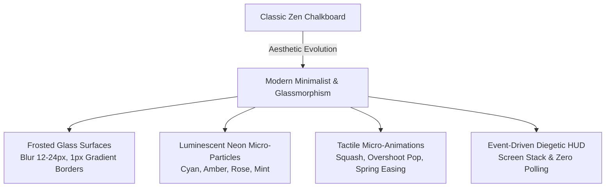
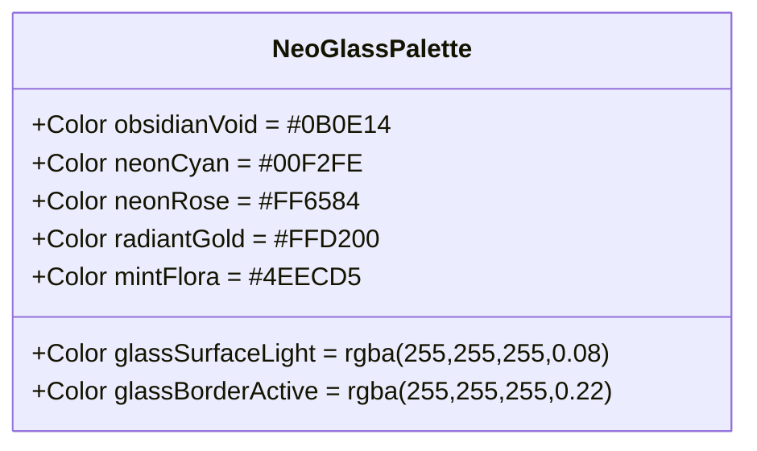
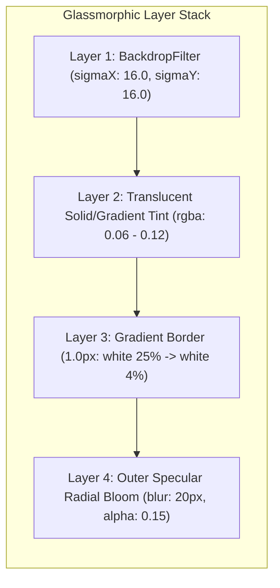
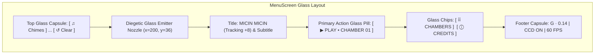
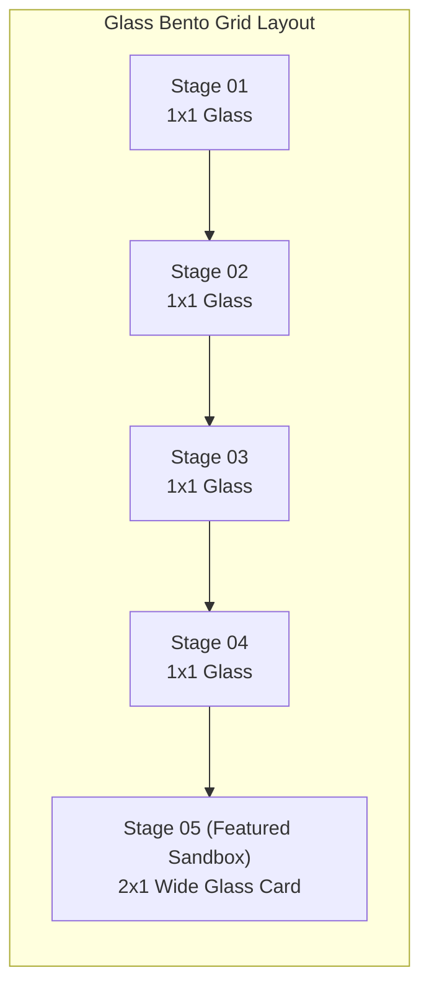
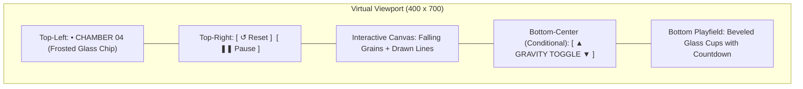
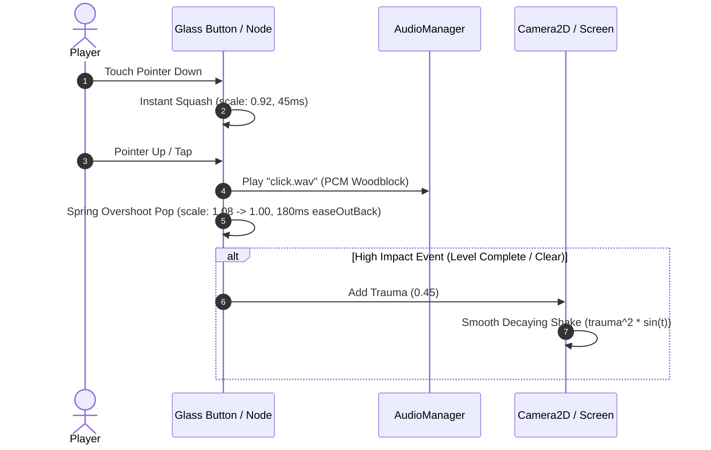
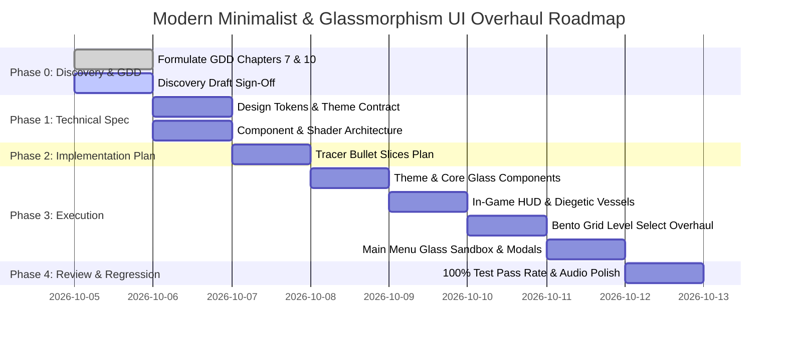

# Game Design Document (GDD): Modern Minimalist & Glassmorphism UI Overhaul
## Project: Micin Micin (Sugar, Sugar Flutter Clone)

> **Document Version:** 2.0.0  
> **Status:** ARCHIVED & SUPERSEDED by Chunky Arcade  
> **Target Framework:** Flutter 3.x (Dart 3.12+)  

> [!WARNING]
> **ARCHIVED & SUPERSEDED BY CHUNKY ARCADE**:
> This document details a historical visual iteration (Glassmorphism) that has been superseded by the canonical **Chunky Arcade** visual identity (`CartoonTokens`, 3D extruded slabs, solid drop shadows, and arcade coin HUD). Refer to [docs/design/art-direction-brief.md](file:///d:/kayzz/flutter/micin/docs/design/art-direction-brief.md), [docs/ARCHITECTURE.md](file:///d:/kayzz/flutter/micin/docs/ARCHITECTURE.md), and [CONTEXT.md](file:///d:/kayzz/flutter/micin/CONTEXT.md) for active system standards.
> **Reference Specs:** `openagenticgame-gdd` (Chapters 7 & 10), `game-ui-ux`, `game-feel`, `physics-tuning`  
> **Created:** 2026-10-05  

---

## 1. Executive Summary & High Concept

### 1.1 The Vision: Luminescent Tactile Glass
**Micin Micin** is transitioning from a classic chalkboard / Japanese rock garden zen theme into a **Modern Minimalist & Glassmorphism** aesthetic. The new visual identity merges sleek dark obsidian surfaces, multi-layered frosted glass panels (`BackdropFilter` blur matrices), luminous neon particle streams, and ultra-crisp geometric glass prisms.

The experience elevates the core puzzle mechanic into an ethereal digital physics lab—satisfying, tactile, and visually captivating without cluttering the screen or degrading the zero-allocation 60/120 FPS physics loop.



### 1.2 Core Pillars
1. **Luminous Depth (Glassmorphism):** High-end frosted glass containers (`rgba(255,255,255,0.06)` to `0.12`), 1px translucent specular gradient borders, and multi-plane ambient glows.
2. **Juice & Tactile Responsiveness (Game Feel):** Immediate spring-based haptic-visual feedback upon touch, button pop with overshoot (`Curves.easeOutBack`), and decaying trauma screen shakes.
3. **Decoupled Architecture (Game UI/UX):** Strict screen-stack state machine with zero boolean flag soup, event-driven HUD updates (reacting strictly to engine streams), and responsive virtual coordinates ($400 \times 700$).
4. **Deterministic Physical Performance (Physics Tuning):** Continuous Collision Detection (CCD) preventing particle tunneling, non-interfering gesture zoning (drawing vs HUD taps), and zero-heap hot loops.

---

## 2. Visual Architecture & Design System (Chapter 10: Game Art)

### 2.1 The Neo-Glass Mineral Palette
The updated color architecture replaces flat earth tones with deep cosmic obsidian and refractive neon minerals:

| Token Name | Hex / RGBA Value | Role / Application |
|---|---|---|
| `obsidianVoid` | `#0B0E14` | Deep canvas floor & letterbox padding |
| `glassSurfaceLight` | `rgba(255, 255, 255, 0.08)` | Frosted glass fill for primary interactive cards & buttons |
| `glassSurfaceSubtle` | `rgba(255, 255, 255, 0.04)` | Secondary backdrop cards & milestone badges |
| `glassBorderActive` | `rgba(255, 255, 255, 0.22)` | 1px top-left light source highlight border |
| `glassBorderInactive` | `rgba(255, 255, 255, 0.08)` | 1px ambient resting border |
| `neonCyan` | `#38EF7D` / `#11998E` $\to$ `#00F2FE` | Primary flow particle / Soft Aqua evolution |
| `neonRose` | `#FF6584` | Pastel chromatic filter evolution (Rose) |
| `radiantGold` | `#FFD200` $\to$ `#F7971E` | Target cup equilibrium & level complete accent |
| `mintFlora` | `#4EECD5` | Tertiary chromatic filter (Sage Green evolution) |
| `specularWhite` | `#FFFFFF` | Core falling sugar particle & typography headings |



### 2.2 Glassmorphic Card Construction
All UI panels, dialogs, and HUD capsules follow the 3-Layer Optical Glass Spec:



---

## 3. Screen Flow & Navigation Architecture (Chapter 7: Interface)

### 3.1 Screen Stack State Machine
Screens operate as an immutable, decoupled stack pushed and popped via `GoRouter` and Flutter `Overlay` systems:

```mermaid
stateDiagram-v2
    [*] --> Splash: App Bootstrap
    Splash --> MainMenu: 2.2s Cascade Dissolve
    MainMenu --> LevelSelect: Tap PLAY / CHAMBERS
    MainMenu --> Credits: Tap CREDITS
    LevelSelect --> MainMenu: Tap Back ‹
    LevelSelect --> GameScreen: Tap Active Stage Node
    
    state GameScreen {
        [*] --> ActivePlay: Init 400x700 Virtual Canvas
        ActivePlay --> PauseOverlay: Tap Pause [❚❚] (Push Stack)
        PauseOverlay --> ActivePlay: Tap Resume [▶] (Pop Stack)
        PauseOverlay --> LevelSelect: Tap Stages [⠿]
        ActivePlay --> VictoryOverlay: All Cups Remaining == 0
        VictoryOverlay --> GameScreen: Tap Next Stage [➔]
        VictoryOverlay --> LevelSelect: Tap Stages [⠿]
    }
```

---

## 4. Screen-by-Screen Interface Specification (Chapter 7: Interface)

### 4.1 Screen 1: Splash Screen (`SplashScreen`)
- **Background:** Deep obsidian void (`#0B0E14`) with a centralized frosted glass circular portal.
- **Centerpiece:** Luminous vertical sugar sand stream cascading through a refractive neon prism, spawning floating specular sugar motes that drift outward.
- **Brand Title:** Minimalist `MICIN MICIN` set in `Outfit` (Weight 300, tracking +8.0), emerging with a 1.2s smooth opacity reveal and glassmorphic shimmer.
- **Transition:** Seamless 550ms crossfade into the Main Menu.

### 4.2 Screen 2: Interactive Glass Sandbox Menu (`MenuScreen`)
- **Header:** Translucent glass capsule with audio toggle (`CHIMES ON / MUTED`) and clear canvas trigger (`CLEAR`).
- **Interactive Sandbox:** Infinite circular particle stream flowing from an ultra-thin glass nozzle at top-center ($x=200, y=36$). Players can drag across the screen to draw glass chalk barriers deflectable with CCD physics.
- **Primary Action (CTA):** Suspended Frosted Glass Pill ("PLAY • ACT I") with breathing cyan edge glow, positioned directly beneath the main logo.
- **Secondary Actions:** Dual floating glass pills (`[ CHAMBERS ]` and `[ CREDITS ]`) with subtle frosted backdrops.
- **Footer:** Delicate glass status bar rendering physics constants (`G · 0.14 px/f²` • `CCD ACTIVE` • `400×700 VIRTUAL`).



### 4.3 Screen 3: Glass Bento Grid Stage Selector (`LevelSelectScreen`)
- **Structure:** Modern Asymmetric Bento Grid grouping all 30 stages into 4 Thematic Acts:
  - *Act I: Flow & Chutes* (Levels 1–7)
  - *Act II: Chromatic Prism* (Levels 8–15)
  - *Act III: Gravitational Inversion* (Levels 16–22)
  - *Act IV: Master Glass Garden* (Levels 23–30)
- **Bento Card Styling:**
  - Standard Stages: $1 \times 1$ frosted glass tiles (`rgba(255,255,255,0.06)`), 1px gradient border, centered clean numeral.
  - Featured Milestones (Levels 5, 10, 18, 25, 30): $2 \times 1$ wide glass cards with real-time particle preview or subtle animated neon shimmer.
- **Stage Node States:**
  - **Completed:** Radiant amber rim (`#FFD200`), translucent gold fill, checkmark glyph.
  - **Current Playable:** Continuous breathing cyan pulse glow, interactive scale pop on hover/touch.
  - **Locked:** Dark obsidian glass (`rgba(0,0,0,0.4)`), lock glyph, and 300ms tactile micro-shake feedback on tap.
- **Act Capsule Quick-Jump Bar:** Floating frosted glass pill at bottom center (`[ I ] [ II ] [ III ] [ IV ]`) that smoothly scrolls to the target act.



### 4.4 Screen 4: In-Game Diegetic HUD (`GameHud` & `GameScreen`)
- **Design Rule:** 100% borderless, zero intrusive container boxes. HUD elements float gracefully at virtual canvas anchors:
  - **Top-Left Anchor:** Minimalist stage numeral (`• CHAMBER 04`) in low-contrast crisp typography.
  - **Top-Right Anchor:** Dual floating glass action chips:
    - Reset: `↺` (Instant line clear & particle reset with kalimba ping)
    - Pause: `❚❚` (Pushes Pause Overlay with 15ms sidechain audio ducking)
  - **Bottom-Center Anchor (On Inversion Stages):** Luminous glass gravity pill with dual chevron indicators (`▲ G-INVERT ▼`), glowing cyan when normal, amber when inverted.
- **Target Cups (Vessels):** Replaced flat basalt walls with beveled frosted glass containers featuring neon aperture glows matching required particle color. Pure countdown integer displayed inside the cup (`remaining = max(0, target - settled)`).



### 4.5 Screen 5: Ambient Glass Pause Overlay (`PauseOverlay`)
- **Background:** Full-bleed hardware gaussian blur (`sigma = 24.0`) with radial obsidian vignette.
- **Chamber Tag:** `• CHAMBER XX •` centered at top with soft letter-spacing.
- **Title:** `PAUSED` in ultra-light `Outfit` (tracking +6.0).
- **Control Cluster:** 3 floating circular frosted glass action glyphs with staggered sinusoidal drift:
  1. `↺` **Restart** (Glass circle, 54px diameter)
  2. `▶` **Resume** (Featured glass circle, 68px diameter, cyan breathing halo)
  3. `⠿` **Stages** (Glass circle, 54px diameter)
- **Soundscape Capsule:** Bottom floating pill toggle: `[ ♫ CHIMES ON / MUTED ]` with tactile click feedback.

### 4.6 Screen 6: Victory Ambiance State (`LevelCompleteDialog`)
- **Atmosphere:** Full-bleed obsidian wash with radiant gold radial light explosion.
- **Equilibrium Badge:** Glassmorphic pill badge displaying `EQUILIBRIUM ACHIEVED`.
- **Dynamic Level Ambiance:** Displays poetic zen reflection tailored to the completed stage from `LevelAmbiance`.
- **Primary CTA:** Luminous gold glass pill (`NEXT CHAMBER ➔` or `RETURN TO SANCTUARY`), triggering spring scale pop on tap.

---

## 5. Game-Feel & Micro-Animation System

### 5.1 Feedback Timing & Importance Tiers



### 5.2 Micro-Animation Specs

| Event | Animation Type | Duration | Easing Curve | Transform / Visual |
|---|---|---|---|---|
| **Button Touch Down** | Quick Squash | 50ms | `Curves.easeOutQuad` | Scale down to `0.92` |
| **Button Release / Tap** | Spring Pop | 220ms | `Curves.easeOutBack` | Overshoot to `1.08`, settle to `1.00` |
| **Locked Node Tap** | Micro-Shake | 300ms | Damped Sinusoidal | Offset horizontal $\pm 6\text{px}$, 4 cycles |
| **Screen Transition** | Glass Dissolve | 450ms | `Curves.easeInOutCubic` | Scale `0.96 \to 1.00`, Opacity `0.0 \to 1.0` |
| **Gravity Inversion** | Flip & Pulse | 350ms | `Curves.elasticOut` | Rotation $180^\circ$, Cyan $\leftrightarrow$ Amber glow shift |
| **Level Complete Bloom**| Radiant Wash | 600ms | `Curves.easeOutCirc` | Radial gradient spread, scale `1.05 \to 1.00` |

---

## 6. Physics Tuning & Gesture Ergonomics

### 6.1 Non-Interfering Gesture Layering
To prevent conflict between drawing line barriers and tapping HUD buttons:
1. **Z-Order Separation:** Interactive HUD chips reside in top-layer widgets wrapped with discrete touch targets ($44 \times 44\text{ pt}$ minimum).
2. **Gesture Discriminator:** Movement threshold $> 4.0\text{ px}$ identifies chalk drawing vs static taps.
3. **Double-Tap Wipe:** Timestamp delta $< 320\text{ ms}$ on empty space triggers instantaneous barrier erasure without timer latency.

### 6.2 Continuous Collision Detection (CCD)
- Particles moving at terminal velocity ($v_{\max} = 4.8\text{ px/f}$) calculate swept raycasts against player lines, eliminating tunneling through thin barrier segments ($< 2.5\text{ px}$).
- Cup floor deflects outward from below, while permitting inner sugar mounds to settle smoothly onto heightmap bins.

---

## 7. Phased Implementation Roadmap



---

## 8. Verification & Acceptance Criteria

1. **Zero-Allocation 60/120 FPS:** Glass blur and rendering must not allocate new objects during hot ticker frames; all CustomPainters must reuse static buffers.
2. **Deterministic Geometry:** All UI and physics render strictly within $400 \times 700$ virtual points with letterbox clamping.
3. **Accessibility & Clarity:** High contrast ratios between neon sugar particles and dark frosted glass backgrounds ($\ge 4.5:1$).
4. **100% Test Passing:** All 157 existing unit, widget, and integration tests must remain green with zero regressions.
