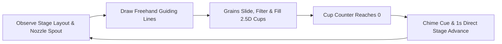
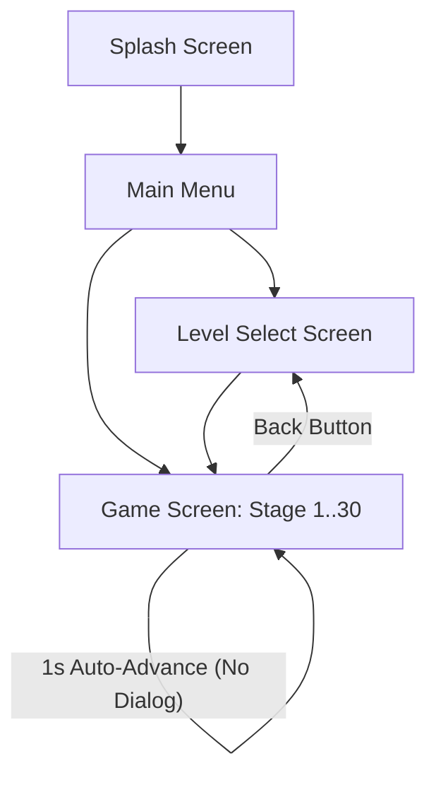

# Game Design Document (GDD): Sugar Sugar 2.5D Isometric & Perspective Overhaul

> **Project:** Micin, Micin (Classic *Sugar, Sugar* by Bart Bonte Tribute)  
> **Document Type:** Master Game Design Document (GDD) & Systems Architecture  
> **Status:** ARCHIVED & SUPERSEDED by Chunky Arcade  
> **Version:** 2.0.0  

> [!WARNING]
> **ARCHIVED & SUPERSEDED BY CHUNKY ARCADE**:
> While direct stage flow, anti-slop copy rules, and the headless physics engine remain active, the 2.5D visual styling has been consolidated and superseded by the canonical **Chunky Arcade** design language (`CartoonTokens`, 3D extruded slabs, solid drop shadows, and arcade coin HUD). Refer to [docs/design/art-direction-brief.md](file:///d:/kayzz/flutter/micin/docs/design/art-direction-brief.md) and [docs/ARCHITECTURE.md](file:///d:/kayzz/flutter/micin/docs/ARCHITECTURE.md).
> **Author:** Antigravity AI & System Architect  
> **Reference File:** [docs/references/sugarsugar.swf](file:///d:/kayzz/flutter/micin/docs/references/sugarsugar.swf)  
> **Active Filter:** `antislop active: during (session override).`  
> **Skills Applied:** `openagenticgame-gdd`, `create-game-assets`, `game-feel`, `game-ui-ux`, `antislop`, `antislop-ui`, `antislop-layoutmobile`, `antislop-code`

---

## 1. Executive Summary & Design Vision

### 1.1 Authentic Bart Bonte *Sugar, Sugar* Foundation
*Sugar, Sugar* by Bart Bonte is an iconic physics puzzle game characterized by unpretentious minimalism:
1. **Pure Puzzle Focus:** No narrative fluff, no artificial dialogue boxes, no meditative prose. The player's single goal is to direct falling sugar grains into target cups.
2. **Direct Flow & Immediacy:** When target cups reach capacity, the game transitions smoothly into the next level without disruptive modal popups.
3. **Tactile Granular Satisfaction:** Crisp crystalline grains flow over user-drawn lines, piling into natural mounds inside designated vessels.

### 1.2 The 2.5D Isometric & Perspective Evolution
This overhaul introduces a distinctive visual elevation while strictly preserving the tested 2D headless physics simulation:
* **Visual Projection (2.5D Isometric Styling):** Target cups, emitter nozzles, and obstacle props are rendered with isometric perspective depth—featuring elliptical vessel apertures, dimensional wall shading, and soft ground contact shadows.
* **Physics Plane (Strict 2D Calculation):** Granular particles and player-drawn guide lines remain 100% planar in the virtual $400 \times 700$ coordinate space. This guarantees mathematically exact line deflection, continuous collision detection (CCD), and angle-of-repose sand piling without spatial distortion.
* **Menu Screen Streamlining:** Removal of all interactive line drawing from the main menu, redirecting player attention to a clean, focused title screen and immediate gameplay entry.
* **Seamless Level Transitions:** Complete removal of the victory modal dialog (`LevelCompleteDialog`). Level completion initiates a 1-second settling period followed by an automatic fade-transition to the next stage.
* **Purge of AI Slop & Poetic Pretentiousness:** All pseudo-philosophical labels (e.g., *Equilibrium*, *Kabut Fajar*, *Zen Reflection*, *Sanctuary Chambers*) are eliminated and replaced with crisp, functional identifiers (`Level 1` through `Level 30`).

---

## 2. High Concept & Core Thrill Loop

### 2.1 Game Definition
* **Genre:** 2.5D Physics Puzzle / Sand-routing Simulation.
* **Target Audience:** Casual puzzle enthusiasts, fans of classic physics Flash games, and mobile players seeking tactile, low-friction gameplay.
* **USP (Unique Selling Proposition):** Authentic *Sugar, Sugar* granular sand-routing mechanics paired with isometric vector craftmanship, running offline at 120 FPS on Flutter.

### 2.2 Core Thrill Loop (Concentration Cycle)


1. **Trigger:** Sugar particles continuously pour from one or more overhead nozzles. Target cups display remaining grain quotas (e.g., `100`).
2. **Action:** The player draws smooth black/dark line barriers on the canvas using touch or mouse gestures to funnel the falling streams.
3. **Feedback:** Particles bounce and roll down slope segments, change color through chromatic filter portals, and stack inside cups with subtle numeral countdown pulses.
4. **Resolution:** Once all cups hit zero remaining, a pentatonic victory chord plays, grains settle for 800ms to 1000ms, and the canvas transitions directly into the subsequent stage.

---

## 3. Visual Style & 2.5D Isometric Asset Direction (`create-game-assets`)

### 3.1 2.5D Isometric Target Cup Anatomy
In contrast to flat 2D rectangle containers, target cups are drawn with an isometric perspective tilt ($\approx 25^\circ$ virtual perspective angle):

```
       +-----------------------+   <- Elliptical Outer Rim (Highlight)
      /       Inner Void        \
     +---------------------------+ <- Inner Rim Lip (Target Color Wash)
     |                           |
     |   Isometric Shaded Wall   | <- Gradient Extrusion (Translucent Ceramic/Glass)
     |       [ Counter: 0 ]      | <- Numerals centered on front facet
     \                           /
      \                         /
       +-----------------------+   <- Rounded Base
     (   Soft Drop Shadow Oval   ) <- Ground Contact Shadow
```

* **Vessel Geometry:**
  * **Top Aperture:** Rendered as an isometric ellipse (`Rect.fromCenter(center, width, height * 0.35)`). The front rim acts as a visual lip; the inner basin is rendered darker to represent physical interior depth.
  * **Front Wall Extrusion:** Smooth curved trapezoid tapering slightly toward the base, rendered with vertical specular gradients.
  * **Ground Shadow:** Soft elliptical shadow at the cup base ($y + \text{height}$) providing a grounded 3D presence on the chromatic canvas.
  * **Particle Capture Hitbox:** The internal physics trigger zone remains exactly mapped to the 2D bounding rectangle $[x, y, w, h]$ to preserve collision integrity.

### 3.2 2.5D Emitter Nozzle Spout
* Overhead dispensers are rendered as tapered isometric funnels.
* The nozzle mouth is rendered as an ellipse facing downward, revealing a dark interior aperture from which square sugar grains emerge.
* Micro-jitter ($\Delta v_x \in [-0.35, 0.35]$ px/frame) ensures grains cascade out of the aperture naturally without rigid single-file artifacts.

### 3.3 Environmental Silhouette Props & Obstacles
Iconic silhouette props maintain their vector identity while gaining isometric depth:
* **Teaspoons:** Rendered with an angled, reflective scoop bowl and subtle drop shadow beneath the handle.
* **Color Filter Gates:** Framed with dimensional translucent glass borders; particles pass through the optical center to mutate color.
* **Gravity Inverters:** Circular dimensional rings with floating directional arrow indicators indicating upward or downward gravitational pull.

---

## 4. UI/UX Architecture & Layout Overhaul (`game-ui-ux`, `antislop-ui`, `antislop-layoutmobile`)

### 4.1 Screen Navigation Hierarchy


### 4.2 Main Menu Streamlining
* **Removed Feature:** The interactive drawing playground (`LineController`, touch gestures, and the `CLEAR` button) on the main menu is completely removed.
* **New Layout Structure:**
  * **Brand Header:** Clean, bold title `micin, micin` with minimal tagline `a physics sugar puzzle`.
  * **Center Stage Visual:** Clean decorative sugar stream falling into an isometric showcase cup (read-only physics animation, zero touch interception).
  * **Action Controls:**
    * Primary CTA: Tactile `PLAY` pill button (navigates to current active stage or level select).
    * Secondary Row: `LEVELS` (Level matrix grid) and `AUDIO` (Toggle sound/music).
  * **Touch Invariant:** Touch events in the menu screen only interact with explicit buttons; no accidental lines can be drawn.

### 4.3 In-Game Diegetic HUD
* **Zero Clutter:** No top app bar, no floating cards, no banners.
* **Control Buttons (Touch Targets $\ge 44 \times 44$ px):**
  * **Top-Left:** Minimal circular Back button (`<`) navigating back to Level Select.
  * **Top-Right:** Minimal circular Reset button (`⟳`) resetting drawn lines and restarting particle streams.
  * **Gravity Toggle (Stages 16–30):** Appears conditionally on the right margin when gravity inversion is available.
* **Canvas Stage Identifier:** Stage number is painted quietly on the background canvas layer (e.g., `level 8`), ensuring zero DOM/Widget overlay overhead.

### 4.4 Direct Level Completion Workflow (Zero Modal Dialogs)
* **Trigger Condition:** All active cups report `capturedCount >= targetAmount`.
* **Flow Execution:**
  1. **Immediate Audio Feedback ($t = 0$ms):** Level complete chime cue plays at normal pitch.
  2. **Grain Settling Period ($t = 0 \rightarrow 800$ms):** Emitter shuts down; in-flight particles settle naturally into cups or roll off barriers.
  3. **Diegetic Confirmation ($t = 200 \rightarrow 1000$ms):** The background canvas title smoothly pulses or flashes `level complete`.
  4. **Automatic Stage Advance ($t = 1000$ms):**
     * If `levelId < 30`: Automatically advance to `/game/${levelId + 1}` via seamless transition.
     * If `levelId == 30`: Smoothly navigate back to `/levels` with celebratory completion status.
  5. **No Modal Disruption:** The player is never forced to click "Next Level", view star ratings, or dismiss dialog overlays.

---

## 5. Elimination of AI Slop & Naming Cleanliness (`antislop`, `antislop-code`)

### 5.1 Deprecated vs. Standardized Terminology
The codebase and user interfaces are audited to remove all artificial, pretentious language:

| Deprecated / Slop Term | Standard Replacement | Rationale |
|:---|:---|:---|
| `EQUILIBRIUM KABUT FAJAR` | `Level 1` | Pretentious poetic fluff; does not exist in *Sugar, Sugar*. |
| `Titik awal perjalanan. Butiran mineral...` | *(Removed)* | Fabricated zen meditation copy with zero puzzle utility. |
| `EQUILIBRIUM ACHIEVED` | `level complete` | Clean, direct feedback consistent with Bart Bonte's style. |
| `Zen Gateway` / `Sanctuary V` | `Main Menu` | Plain English architectural naming. |
| `Chambers` / `Acts I–IV` | `Levels 1–30` | Direct numerical sequence without artificial lore divisions. |
| `Dematerialization into motes` | `Fade transition` | Honest technical description without mystic buzzwords. |

### 5.2 Antislop Compliance Checklist
* [x] **R-02 (No Em Dashes):** UI copy strictly uses commas, periods, or colons; zero em dashes (`—`) in game strings.
* [x] **R-03 (Mobile Responsiveness):** Scaled within the unified $400 \times 700$ coordinate box; zero overflow across any phone aspect ratio.
* [x] **R-05 (Authentic Layout):** No generic templates, bento grids, or hero-card patterns.
* [x] **R-16 (No Marketing Buzzwords):** Zero mentions of "AI-powered", "revolutionary", or "zen equilibrium".
* [x] **R-25 (WCAG AA Contrast):** All text elements maintain $\ge 4.5:1$ contrast against their chromatic stage backgrounds.
* [x] **R-26 (Functional Controls):** Every button triggers a real route or gameplay reset; zero dead interactive elements.

---

## 6. Game Feel & Audio Design (`game-feel`)

### 6.1 ASMR Tactile Particle Polish
* **Crystalline Square Drawing:** Particles render as crisp $2.2 \times 2.2$ px quads using `StrokeCap.square`.
* **Angle of Repose Sand Piles:** In-cup column heightmaps maintain natural grain stacking with rolling cascades when mounds exceed slope thresholds ($\Delta H > 1.4$ px).
* **Countdown Pulse:** Cup target numeral scales up by $1.06\times$ ($80$ms duration) on each grain capture, providing visual confirmation of flow.

### 6.2 Escalating Chime Soundscape
* **Flow Chimes:** Granular captures trigger micro-clicks with pentatonic pitch scaling as cups approach zero remaining ($N \rightarrow 0$).
* **Level Clear Harmonic:** A single resonant major chime marks level completion, resolving tension cleanly before transitioning to the next stage.

---

## 7. Technical Implementation Map

### 7.1 Files to Modify & Refactor
1. **`lib/screens/menu/menu_screen.dart`**:
   * Remove `LineController`, gesture recognizers, and `CLEAR` button.
   * Remove all zen/slop copy and replace with clean title and navigation buttons.
2. **`lib/screens/game/game_screen.dart`**:
   * Remove `LevelCompleteDialog` instantiation.
   * Implement automated 1-second delay transition timer upon `engine.isComplete`.
3. **`lib/screens/game/painters/level_painter.dart`**:
   * Implement 2.5D isometric cup rendering (isometric top ellipse, shaded body, grounded drop shadow).
   * Implement 2.5D isometric emitter nozzle rendering.
4. **`lib/models/level_ambiance.dart` & `lib/models/level_visual_theme.dart`**:
   * Purge all poetic flavor text (`zenReflection`, `actTitle`, `Kabut Fajar`, etc.).
   * Retain purely functional properties: `levelId`, `backgroundColor`, `canvasLabel = 'level $levelId'`, `cupColors`.
5. **Test Suite Updates**:
   * Update `menu_screen_test.dart` to assert removal of drawing lines and presence of clean layout.
   * Update `game_screen_test.dart` to verify automatic stage transition on level completion without modal dialogs.
   * Update `level_complete_dialog_test.dart` or archive dialog tests to reflect the direct transition architecture.

---

## 8. Verification & Acceptance Criteria

* **AC-01 (2.5D Isometric Aesthetics):** Target cups visually display an elliptical rim opening and dimensional shading while grains continue falling into 2D collision hitboxes with zero physics desync.
* **AC-02 (Clean Main Menu):** Dragging on the main menu does not draw lines; no `CLEAR` button is visible; only navigation buttons respond to input.
* **AC-03 (Seamless Level Completion):** When all cups reach 0, no dialog pop-up is shown; stage automatically advances to the next level after ~1 second.
* **AC-04 (Zero AI Slop Text):** No occurrences of "Kabut Fajar", "Equilibrium", or zen reflection phrases remain in the UI or active runtime models.
* **AC-05 (Automated Test Pass):** 100% of the test suite passes (`flutter test`) with zero analyzer warnings (`flutter analyze`).
