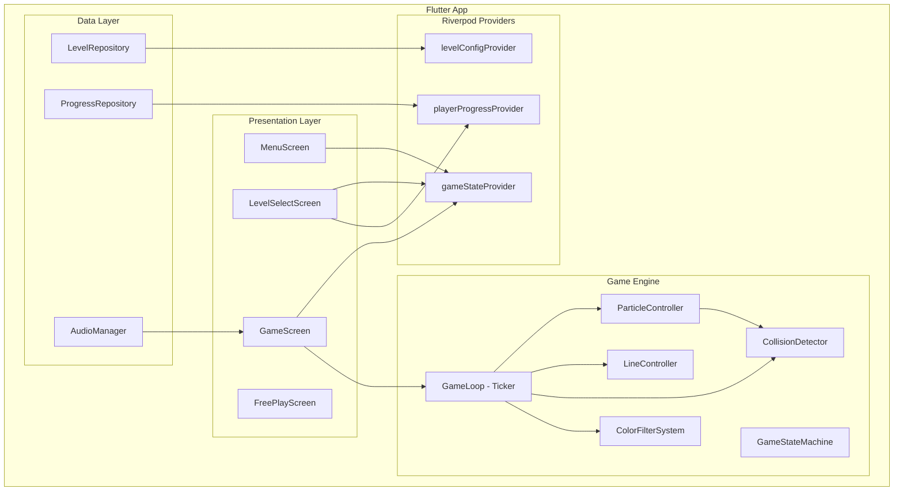
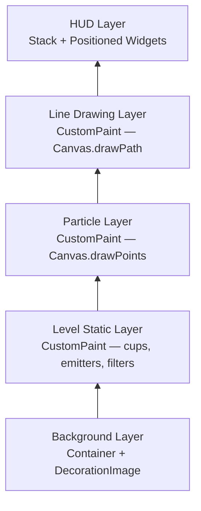
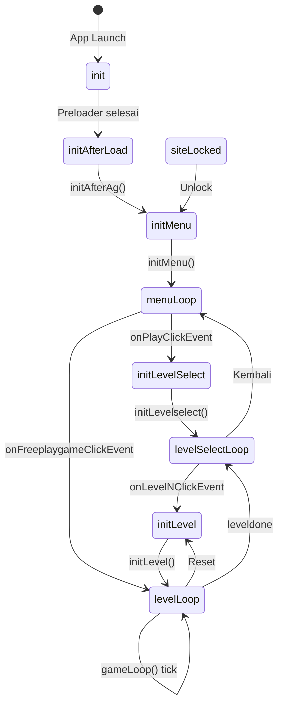
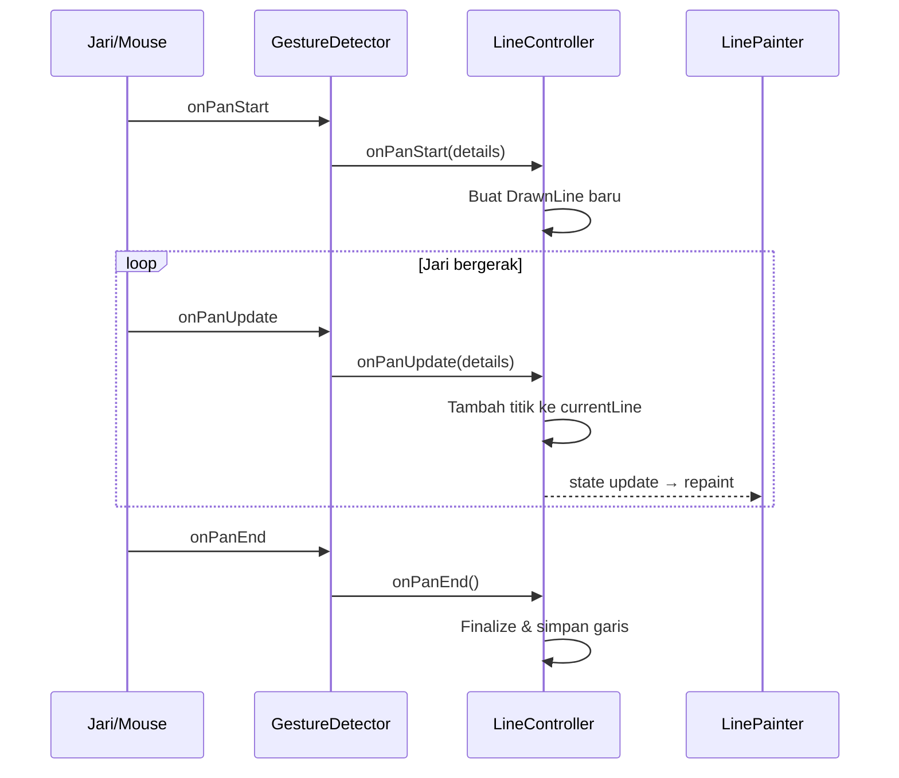
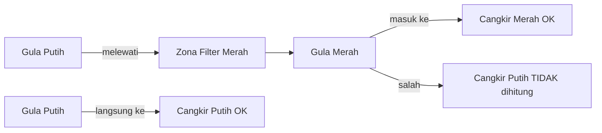
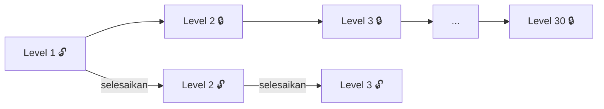
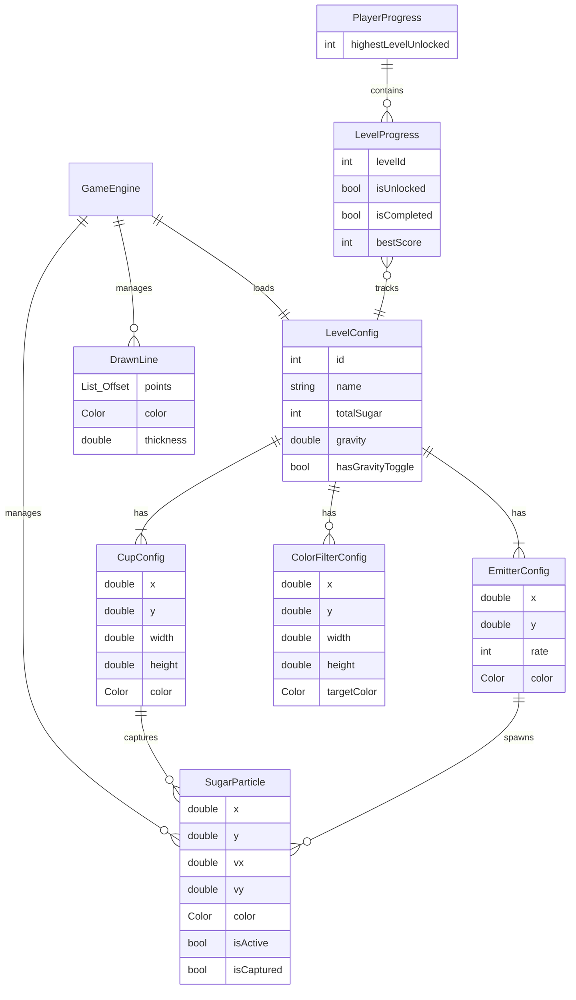
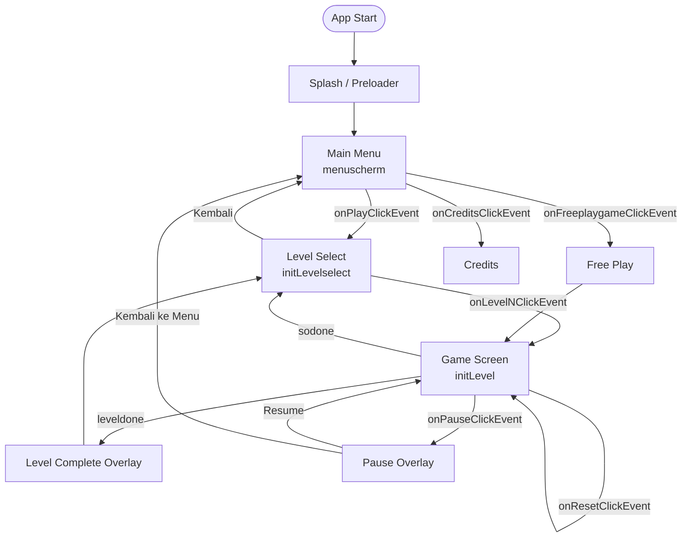
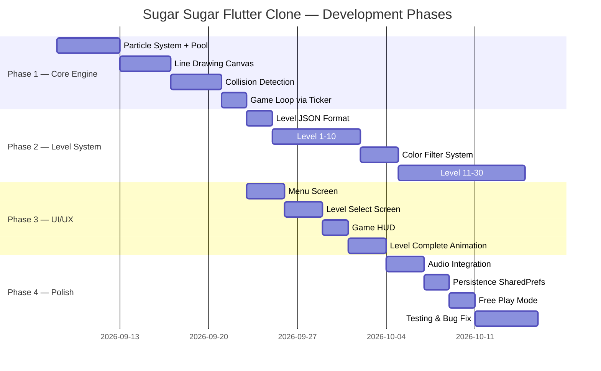

# Technical Design Document (TDD): Sugar Sugar — Flutter Clone

> **Source Analysis**: Reverse-engineered from `sugarsugar.swf` (SWF v10, CWS compressed, ~880 KB)
> **Original Game**: Sugar Sugar by Bart Bonte — [bontegames.com](https://www.bontegames.com)
> **Target Platform**: Flutter (Android, iOS, Web)
> **Flutter Version**: 3.44.8 (Dart 3.12.2)
> **Document Version**: 1.1
> **Date**: 2026-09-07

---

## Table of Contents

1. [Executive Summary](#1-executive-summary)
2. [Game Overview](#2-game-overview)
3. [Architecture Overview](#3-architecture-overview)
4. [State Machine](#4-state-machine)
5. [Core Systems](#5-core-systems)
6. [Level System](#6-level-system)
7. [Data Models](#7-data-models)
8. [UI & Screen Flow](#8-ui--screen-flow)
9. [Audio System](#9-audio-system)
10. [Persistence & Progression](#10-persistence--progression)
11. [Flutter Implementation Plan](#11-flutter-implementation-plan)
12. [Dependencies](#12-dependencies)
13. [Appendix](#appendix)

---

## 1. Executive Summary

Sugar Sugar adalah game puzzle berbasis fisika di mana pemain menggambar garis di kanvas untuk mengarahkan partikel gula yang jatuh ke dalam cangkir target. TDD ini mendefinisikan desain teknis lengkap untuk Flutter clone yang diturunkan dari analisis langsung binary SWF.

### Key Extracted Facts dari SWF Binary

| Property | Nilai |
|---|---|
| SWF Version | 10 (Flash Player 10) |
| Kompresi | CWS (zlib) — 880 KB raw / 973 KB decompressed |
| Total Level | **30** (confirmed: `knoplevel1`..`knoplevel30`) |
| Total Frames | **32+** (frame218 = frame preloader/menu) |
| ActionScript | AS3 |
| Domain Asli | `www.bontegames.com` |
| Partner Distribusi | `www.armorgames.com` |

### Flutter Stack

| Concern | Teknologi |
|---|---|
| Framework | **Flutter 3.44.8** / Dart 3.12.2 |
| Rendering | `CustomPainter` + `Canvas` API |
| Game Loop | `Ticker` (via `SingleTickerProviderStateMixin`) |
| State Management | **Riverpod 2.x** |
| Persistence | `shared_preferences` |
| Audio | `audioplayers` |
| Level Data | JSON assets (`assets/levels/`) |
| Fisika | Custom (tidak perlu game engine berat) |
| Target Platform | Android, iOS, Web |

---

## 2. Game Overview

### 2.1 Core Gameplay Loop

```
Pemain membuka level
        │
        ▼
Partikel gula spawn dari emitter
        │
        ▼
Pemain menggambar garis dengan jari/mouse
        │
        ▼
Gula meluncur di atas garis mengikuti gravitasi
        │
        ▼
Gula jatuh ke dalam cangkir target
        │
        ▼
numSugar == numSugarMax? ──YA──▶ Level Selesai → Level Berikutnya
        │
       TIDAK
        │
        ▼
Lanjutkan menggambar / tunggu semua gula jatuh
```

### 2.2 Core Mechanics

| Mechanic | Deskripsi | SWF Source |
|---|---|---|
| **Partikel Gula** | Partikel kecil yang jatuh karena gravitasi | `suiker`, `suikerBmp` |
| **Menggambar Garis** | Pemain menggambar garis bebas di kanvas | `lineBmp`, `lineToK` |
| **Gravitasi** | Gaya ke bawah konstan pada semua partikel | `gravitatie`, `gravit` |
| **Deteksi Cangkir** | Collision detection untuk menangkap partikel | `tasshapemovie_54` |
| **Color Filter** | Zona warna yang mengubah warna gula | `suikerfilter_58`, `filterkleur1..5` |
| **Gravity Toggle** | Tombol untuk membalik arah gravitasi | `gravitknop` |
| **Free Play** | Mode sandbox tanpa batas | `knopfreeplaygame` |
| **Level Lock** | Unlock progresif antar level | `locksymb`, `unlock` |

---

## 3. Architecture Overview

### 3.1 High-Level Architecture



### 3.2 Layer Rendering Stack (Flutter)



### 3.3 Widget Tree (GameScreen)

```
GameScreen (StatefulWidget + SingleTickerProviderStateMixin)
└── Stack
    ├── GameBackground()                    ← zandscherm
    ├── RepaintBoundary
    │   └── CustomPaint (LevelPainter)      ← cups, emitters, filter zones
    ├── RepaintBoundary
    │   └── CustomPaint (ParticlePainter)   ← suikerBmp
    ├── RepaintBoundary
    │   └── CustomPaint (LinePainter)       ← lineBmp
    ├── GestureDetector                     ← MOUSE_DOWN/MOVE/UP
    └── GameHud()                           ← pause, reset, music, counter
```

---

## 4. State Machine

> **Source**: Identifier `STATE_*` dikonfirmasi langsung dari binary SWF

### 4.1 State Diagram



### 4.2 GameState Enum (Dart)

```dart
// lib/core/game_state.dart
enum GameState {
  init,
  initAfterLoad,
  initMenu,
  menuLoop,
  initLevelSelect,
  levelSelectLoop,
  initLevel,
  levelLoop,
  siteLocked,
}
```

### 4.3 GameStateMachine

```dart
// lib/engine/game_state_machine.dart
class GameStateMachine extends StateNotifier<GameState> {
  GameStateMachine() : super(GameState.init);

  void transition(GameState next) => state = next;
  void onPlayPressed() => transition(GameState.initLevelSelect);
  void onLevelSelected() => transition(GameState.initLevel);
  void onLevelComplete() => transition(GameState.levelSelectLoop);
  void onReset() => transition(GameState.initLevel);
  void onBackToMenu() => transition(GameState.menuLoop);
}

final gameStateMachineProvider =
    StateNotifierProvider<GameStateMachine, GameState>(
  (ref) => GameStateMachine(),
);
```

---

## 5. Core Systems

### 5.1 Particle System (Sugar)

> **Source**: `suiker`, `suikerBmp`, `numSugar`, `numSugarMax`, `indivvaldelay`, `maxindivvaldelay`

#### 5.1.1 SugarParticle

```dart
// lib/engine/particle/sugar_particle.dart
class SugarParticle {
  double x, y, vx, vy;
  Color color;       // sugarkleur
  bool isActive;
  bool isCaptured;

  SugarParticle({
    required this.x,
    required this.y,
    this.vx = 0,
    this.vy = 0,
    this.color = const Color(0xFFFFFFFF),
    this.isActive = false,
    this.isCaptured = false,
  });

  void reset() {
    isActive = false;
    isCaptured = false;
    vx = 0;
    vy = 0;
    color = const Color(0xFFFFFFFF);
  }
}
```

#### 5.1.2 Object Pool

```dart
// lib/engine/particle/particle_pool.dart
class ParticlePool {
  final List<SugarParticle> _pool;

  ParticlePool({int capacity = 500})
      : _pool = List.generate(capacity, (_) => SugarParticle(x: 0, y: 0));

  SugarParticle? acquire() {
    for (final p in _pool) {
      if (!p.isActive) return p..isActive = true;
    }
    return null;
  }

  void release(SugarParticle p) => p.reset();

  List<SugarParticle> get activeParticles =>
      _pool.where((p) => p.isActive && !p.isCaptured).toList();
}
```

#### 5.1.3 Particle Physics Update

```dart
void update({
  required List<LineSegment> lines,
  required List<CupHitbox> cups,
  required List<ColorFilterZone> filters,
  required double canvasHeight,
}) {
  // Spawn dari emitter
  for (final emitter in emitters) {
    emitter.tick(pool);
  }

  for (final p in pool.activeParticles) {
    // Gravitasi
    p.vy += gravity; // gravitatie

    // Color filter zone
    for (final f in filters) {
      if (f.contains(p.x, p.y)) p.color = f.targetColor;
    }

    // Collision dengan garis
    for (final seg in lines) {
      if (seg.resolveCollision(p)) break;
    }

    // Update posisi
    p.x += p.vx;
    p.y += p.vy;

    // Collision dengan cangkir
    for (final cup in cups) {
      if (cup.matches(p) && cup.contains(p.x, p.y)) {
        p.isCaptured = true;
        cup.capturedCount++;
        capturedCount++;
        break;
      }
    }

    // Keluar layar → release
    if (p.y > canvasHeight + 10) pool.release(p);
  }
}
```

### 5.2 Line Drawing System

> **Source**: `lineBmp`, `lineToK`, `moveTo`, `startDrawCanvas`, `MOUSE_DOWN/MOVE/UP`

#### 5.2.1 DrawnLine & LineSegment

```dart
// lib/engine/drawing/drawn_line.dart
class DrawnLine {
  final List<Offset> points;
  final Color color;      // tekenkleur
  final double thickness; // lineStyle thickness

  const DrawnLine({
    required this.points,
    required this.color,
    this.thickness = 6.0,
  });

  List<LineSegment> toSegments() {
    if (points.length < 2) return [];
    return List.generate(
      points.length - 1,
      (i) => LineSegment(start: points[i], end: points[i + 1], thickness: thickness),
    );
  }
}
```

#### 5.2.2 Drawing Flow



### 5.3 Collision Detection

> **Source**: `getPixel`, `tasshapemovie_54`

> [!IMPORTANT]
> Original SWF pakai **pixel-sampling** (`BitmapData.getPixel()`). Flutter tidak expose pixel data dari `CustomPainter`. Gunakan **geometric segment distance** sebagai gantinya.

```dart
// lib/engine/collision/line_segment.dart
class LineSegment {
  final Offset start, end;
  final double thickness;

  const LineSegment({required this.start, required this.end, this.thickness = 6.0});

  double distanceTo(Offset p) {
    final dx = end.dx - start.dx;
    final dy = end.dy - start.dy;
    final lenSq = dx * dx + dy * dy;
    if (lenSq == 0) return (p - start).distance;
    double t = ((p.dx - start.dx) * dx + (p.dy - start.dy) * dy) / lenSq;
    t = t.clamp(0.0, 1.0);
    return (p - Offset(start.dx + t * dx, start.dy + t * dy)).distance;
  }

  Offset get normal {
    final dx = end.dx - start.dx;
    final dy = end.dy - start.dy;
    final len = sqrt(dx * dx + dy * dy);
    return Offset(-dy / len, dx / len);
  }

  bool resolveCollision(SugarParticle p, {double radius = 2.0}) {
    if (distanceTo(Offset(p.x, p.y)) > radius + thickness / 2) return false;
    final n = normal;
    final dot = p.vx * n.dx + p.vy * n.dy;
    if (dot < 0) {
      p.vx -= 2 * dot * n.dx * 0.3;
      p.vy -= 2 * dot * n.dy * 0.3;
    }
    p.vx *= 0.92;
    p.vy *= 0.92;
    return true;
  }
}
```

### 5.4 Color Filter System

> **Source**: `suikerfilter_58`, `filterkleur1`..`filterkleur5`



```dart
// lib/engine/color_filter/color_filter_zone.dart
class ColorFilterZone {
  final Rect region;
  final Color targetColor; // filterkleur1..5

  const ColorFilterZone({required this.region, required this.targetColor});

  bool contains(double x, double y) => region.contains(Offset(x, y));
}
```

### 5.5 Game Loop (Ticker)

```dart
// lib/engine/game_engine.dart
class GameEngine with ChangeNotifier {
  late final Ticker _ticker;
  final ParticleController particleController;
  final LineController lineController;
  final LevelConfig levelConfig;
  bool isPaused = false;

  void start(TickerProvider vsync) {
    _ticker = vsync.createTicker(_onTick)..start();
  }

  void _onTick(Duration elapsed) {
    if (isPaused) return;
    particleController.update(
      lines: lineController.allSegments,
      cups: levelConfig.cups.map((c) => c.toHitbox()).toList(),
      filters: levelConfig.filters.map((f) => f.toZone()).toList(),
      canvasHeight: levelConfig.canvasHeight,
    );
    if (isLevelComplete) notifyListeners();
    notifyListeners();
  }

  bool get isLevelComplete =>
      particleController.capturedCount >= levelConfig.totalSugar &&
      particleController.emitters.every((e) => e.isExhausted);

  @override
  void dispose() {
    _ticker.dispose();
    super.dispose();
  }
}
```

---

## 6. Level System

### 6.1 Jumlah Level

> **Dikonfirmasi dari SWF**: 30 level (`knoplevel1`..`knoplevel30`)

### 6.2 Level Config

```dart
// lib/models/level_config.dart
class LevelConfig {
  final int id;
  final String name;
  final List<EmitterConfig> emitters;
  final List<CupConfig> cups;
  final List<ColorFilterConfig> filters;
  final int totalSugar;        // numSugarMax
  final double gravity;        // gravitatie
  final bool hasGravityToggle; // gravitknop

  const LevelConfig({
    required this.id,
    required this.name,
    required this.emitters,
    required this.cups,
    this.filters = const [],
    required this.totalSugar,
    this.gravity = 0.2,
    this.hasGravityToggle = false,
  });

  factory LevelConfig.fromJson(Map<String, dynamic> json) => LevelConfig(
        id: json['id'] as int,
        name: json['name'] as String,
        emitters: (json['emitters'] as List)
            .map((e) => EmitterConfig.fromJson(e)).toList(),
        cups: (json['cups'] as List)
            .map((c) => CupConfig.fromJson(c)).toList(),
        filters: (json['filters'] as List? ?? [])
            .map((f) => ColorFilterConfig.fromJson(f)).toList(),
        totalSugar: json['totalSugar'] as int,
        gravity: (json['gravity'] as num?)?.toDouble() ?? 0.2,
        hasGravityToggle: json['hasGravityToggle'] as bool? ?? false,
      );
}
```

### 6.3 Level Data JSON

```json
{
  "id": 1,
  "name": "Level 1",
  "totalSugar": 100,
  "gravity": 0.2,
  "hasGravityToggle": false,
  "emitters": [
    { "x": 0.5, "y": 0.05, "rate": 3, "color": "#FFFFFF" }
  ],
  "cups": [
    { "x": 0.45, "y": 0.85, "width": 0.10, "height": 0.08, "color": "#FFFFFF" }
  ],
  "filters": []
}
```

> Koordinat menggunakan **normalized 0.0–1.0** relatif terhadap ukuran canvas.

### 6.4 Level Progression



### 6.5 Win Condition

```dart
bool isLevelComplete() =>
    capturedSugar >= totalSugar && emitters.every((e) => e.isExhausted);
```

---

## 7. Data Models

### 7.1 Entity Relationship Diagram



---

## 8. UI & Screen Flow

### 8.1 Screen Navigation



### 8.2 HUD Elements

| Element | SWF ID | Flutter Widget | Condition |
|---|---|---|---|
| Pause | `pauseknop` | `IconButton(Icons.pause)` | Selalu |
| Reset | `resetknop` | `IconButton(Icons.refresh)` | Selalu |
| Music | `musicknop` | `IconButton(Icons.music_note)` | Selalu |
| Gravity | `gravitknop` | `IconButton(Icons.swap_vert)` | `hasGravityToggle` |
| Counter | `numSugar/Max` | `Text('$captured/$total')` | Selalu |
| Level | `levelchoise` | `Text('Level $id')` | Selalu |

### 8.3 Particle Painter (Performa)

```dart
// lib/screens/game/painters/particle_painter.dart
class ParticlePainter extends CustomPainter {
  final List<SugarParticle> particles;
  ParticlePainter(this.particles);

  @override
  void paint(Canvas canvas, Size size) {
    final paint = Paint()..strokeWidth = 2.0;
    // Batch render per warna untuk efisiensi maksimal
    final Map<Color, List<Offset>> groups = {};
    for (final p in particles) {
      groups.putIfAbsent(p.color, () => []).add(Offset(p.x, p.y));
    }
    for (final entry in groups.entries) {
      paint.color = entry.key;
      canvas.drawPoints(PointMode.points, entry.value, paint);
    }
  }

  @override
  bool shouldRepaint(ParticlePainter old) => true;
}
```

---

## 9. Audio System

> **Source**: `sugarSong`, `sugarSongPlaying`, `myChannel`, `OkSound`, `musicknop`

```dart
// lib/audio/audio_manager.dart
class AudioManager {
  final AudioPlayer _bgm = AudioPlayer();
  final AudioPlayer _sfx = AudioPlayer();
  bool isMusicEnabled = true;

  Future<void> init() async {
    await _bgm.setReleaseMode(ReleaseMode.loop);
    await _bgm.setSource(AssetSource('audio/sugar_song.mp3'));
  }

  Future<void> playBgm() async {
    if (isMusicEnabled) await _bgm.resume();
  }

  Future<void> playSfx(SoundType type) async {
    final asset = switch (type) {
      SoundType.levelComplete => 'audio/ok_sound.mp3',
      SoundType.buttonClick   => 'audio/click.mp3',
      SoundType.sugarFill     => 'audio/fill.mp3',
    };
    await _sfx.play(AssetSource(asset));
  }

  void toggleMusic() {
    isMusicEnabled = !isMusicEnabled;
    isMusicEnabled ? playBgm() : _bgm.pause();
  }
}

enum SoundType { levelComplete, sugarFill, buttonClick }
```

---

## 10. Persistence & Progression

> **Source**: `SharedObject.getLocal("sugarshared")`, `hoogste`, `locksymb`, `sodone`

```dart
// lib/data/progress_repository.dart
class ProgressRepository {
  static const _key = 'sugarshared'; // mapping dari Flash SharedObject

  Future<PlayerProgress> load() async {
    final prefs = await SharedPreferences.getInstance();
    final json = prefs.getString(_key);
    return json == null
        ? PlayerProgress.initial()
        : PlayerProgress.fromJson(jsonDecode(json));
  }

  Future<void> save(PlayerProgress p) async {
    final prefs = await SharedPreferences.getInstance();
    await prefs.setString(_key, jsonEncode(p.toJson()));
  }

  Future<void> unlockLevel(int id) async =>
      save((await load()).withUnlocked(id));       // locksymb → unlock

  Future<void> markCompleted(int id) async =>
      save((await load()).withCompleted(id));      // sodone / leveldone

  Future<void> saveBestScore(int id, int score) async =>
      save((await load()).withBestScore(id, score)); // hoogste
}
```

---

## 11. Flutter Implementation Plan

### 11.1 Folder Structure

```
lib/
├── main.dart
├── app.dart                          # MaterialApp + GoRouter + ProviderScope
├── core/
│   ├── constants.dart
│   ├── game_state.dart               # GameState enum
│   ├── extensions.dart
│   └── theme.dart
├── engine/
│   ├── game_engine.dart              # Orchestrator + Ticker
│   ├── particle/
│   │   ├── sugar_particle.dart
│   │   ├── particle_pool.dart        # Object pool
│   │   ├── particle_emitter.dart
│   │   └── particle_controller.dart
│   ├── drawing/
│   │   ├── drawn_line.dart
│   │   ├── line_segment.dart
│   │   └── line_controller.dart
│   ├── collision/
│   │   ├── collision_detector.dart
│   │   └── cup_hitbox.dart
│   └── color_filter/
│       └── color_filter_zone.dart
├── models/
│   ├── level_config.dart
│   ├── cup_config.dart
│   ├── emitter_config.dart
│   ├── color_filter_config.dart
│   ├── level_progress.dart
│   └── player_progress.dart
├── data/
│   ├── level_repository.dart
│   └── progress_repository.dart
├── audio/
│   └── audio_manager.dart
├── providers/
│   ├── game_state_provider.dart
│   ├── level_config_provider.dart
│   ├── player_progress_provider.dart
│   └── audio_provider.dart
├── screens/
│   ├── splash/splash_screen.dart
│   ├── menu/menu_screen.dart
│   ├── level_select/
│   │   ├── level_select_screen.dart
│   │   └── level_button.dart
│   ├── game/
│   │   ├── game_screen.dart
│   │   ├── game_hud.dart
│   │   └── painters/
│   │       ├── particle_painter.dart
│   │       ├── line_painter.dart
│   │       ├── level_painter.dart
│   │       └── background_painter.dart
│   └── free_play/free_play_screen.dart
└── widgets/
    ├── lock_badge.dart
    ├── level_complete_dialog.dart
    └── pause_overlay.dart

assets/
├── levels/
│   ├── level_01.json .. level_30.json
├── audio/
│   ├── sugar_song.mp3
│   ├── ok_sound.mp3
│   └── click.mp3
└── images/
    ├── background_sand.png
    └── cup_sprite.png
```

### 11.2 Development Phases



### 11.3 Performance Notes

> [!IMPORTANT]
> **Particle Rendering**: Gunakan `canvas.drawPoints(PointMode.points, offsets, paint)` untuk batch render — **jangan** `drawCircle()` per partikel. Ini setara dengan `BitmapData.setPixel32()` di Flash.

> [!WARNING]
> **Object Pool**: Jangan instansiasi `SugarParticle` baru setiap frame. Gunakan `ParticlePool` untuk reuse objek dan minimasi GC pressure.

> [!TIP]
> **RepaintBoundary**: Bungkus setiap `CustomPaint` layer dengan `RepaintBoundary`. Layer garis yang sudah selesai tidak perlu direpaint setiap frame.

> [!NOTE]
> **Gravity Toggle** (`gravitknop`): Simpan sebagai `double gravityY`. Positif = ke bawah, negatif = ke atas.

---

## 12. Dependencies

```yaml
# pubspec.yaml (relevant section)
environment:
  sdk: ">=3.12.2 <4.0.0"
  flutter: ">=3.44.8"

dependencies:
  flutter:
    sdk: flutter
  flutter_riverpod: ^2.6.1      # State management
  riverpod_annotation: ^2.3.5
  audioplayers: ^6.1.0          # Audio (sugarSong, OkSound)
  shared_preferences: ^2.3.2    # Persistence (sugarshared)
  go_router: ^14.6.0            # Navigation
  freezed_annotation: ^2.4.4   # Immutable models

dev_dependencies:
  flutter_test:
    sdk: flutter
  build_runner: ^2.4.13
  riverpod_generator: ^2.4.3
  freezed: ^2.5.7
  json_serializable: ^6.8.0
  mocktail: ^1.0.4
  flutter_lints: ^5.0.0
```

---

## Appendix

### Appendix A: SWF Symbol Map ke Flutter

| SWF Symbol | Flutter Equivalent |
|---|---|
| `sugar_fla` (main timeline) | `GameScreen` + `GameEngine` |
| `suikerfilter_58` | `ColorFilterZone` |
| `tasshapemovie_54` | `CupHitbox` + cup painter |
| `unlockmovie_44` | `LevelUnlockAnimation` widget |
| `rand_59` | `dart:math Random` |
| `suiker` | `SugarParticle` |
| `suikerBmp` | `ParticlePainter` canvas |
| `lineBmp` | `LinePainter` canvas |
| `screenBmp` | Stack of `CustomPaint` layers |
| `menuscherm` | `MenuScreen` |
| `zandscherm` | `BackgroundPainter` |
| `gameLoop()` | `_onTick()` dalam `GameEngine` |
| `levelLoop` | `_updateLevel()` dalam `GameEngine` |
| `initLevel()` | `LevelRepository.loadLevel()` |
| `numSugar` | `ParticleController.capturedCount` |
| `numSugarMax` | `LevelConfig.totalSugar` |
| `sugarshared` | SharedPreferences key `sugarshared` |
| `hoogste` | `LevelProgress.bestScore` |
| `indivvaldelay` | `ParticleEmitter.emitRate` |
| `gravitatie` | `ParticleController.gravity` |
| `gravitknop` | Gravity toggle `IconButton` |
| `tekenkleur` | `DrawnLine.color` |
| `tastint` | `CupConfig.color` |
| `sugarkleur` | `SugarParticle.color` |
| `filterkleur1..5` | `ColorFilterZone.targetColor` |
| `backkleur` | `AppTheme.backgroundColor` |
| `locksymb` | `LockBadge` widget |
| `unlock` | `ProgressRepository.unlockLevel()` |
| `sodone` | `LevelProgress.isCompleted` |
| `myChannel` | `AudioPlayer` instance |
| `sugarSong` | `assets/audio/sugar_song.mp3` |
| `OkSound` | `assets/audio/ok_sound.mp3` |

### Appendix B: Color System

| SWF Identifier | Role | Dart Field |
|---|---|---|
| `sugarkleur` | Warna partikel gula | `SugarParticle.color` |
| `tekenkleur` | Warna garis gambar | `DrawnLine.color` |
| `tastint` | Warna cangkir | `CupConfig.color` |
| `filterkleur1..5` | Warna zona filter | `ColorFilterZone.targetColor` |
| `backkleur` | Warna background | `AppTheme.backgroundColor` |
