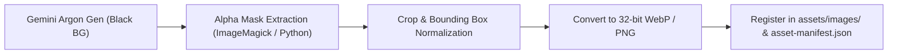

# Gemini Argon Asset Generation Guide: Micin Micin (Chunky Arcade Edition)

> **Document Type:** Canonical 2D Asset Generation Specification & Prompt Bible  
> **Project:** Micin Micin (Flutter 2D Physics Granular Arcade Puzzle)  
> **Design Core:** Chunky Arcade / High-Energy Tactile Physics Puzzle  
> **Target Viewport:** $400 \times 700$ Virtual Resolution (`VirtualCoordinateAdapter`)  
> **Target AI Generator:** Google Gemini Argon (Imagen 3 / Gemini Advanced Image Generator)  
> **Document Status:** Production Ready  

---

## 1. Executive Summary & Aesthetic Guardrails

This document contains the complete technical asset matrix and prompt engineering recipes for generating all visual assets for **Micin Micin** using **Gemini Argon**.

### 1.1 Aesthetic Pillars (Chunky Arcade)
1. **Extruded 3D Slabs & Solid Hard Shadows:** Every interactive control, receptacle, and badge features solid geometric bevels and a crisp 4px vertical drop shadow (`Offset(0, 4)` in matching darker hue). Zero blurry drop shadows or noisy gradients.
2. **Specular Curved Gloss:** Upper 40% of surfaces feature a clean semi-translucent white specular gloss highlight (`#66FFFFFF`).
3. **Vibrant Candy Palette (`CartoonTokens`):**
   - **Canvas Midnight Indigo:** `#110C29` to `#1E1645` (Accent: `#241C52`, Border: `#45368E`)
   - **Emerald Green (Play/Primary):** `#4ADE80` (Base) | `#16A34A` (Mid) | `#15803D` (Extrusion)
   - **Radiant Amber/Gold (Stars/Coins):** `#FBBF24` (Base) | `#D97706` (Mid) | `#B45309` (Extrusion)
   - **Vivid Cyan (Utility/Reset):** `#38BDF8` (Base) | `#0284C7` (Mid) | `#0369A1` (Extrusion)
   - **Energetic Coral (Pause/Danger):** `#FB7185` (Base) | `#E11D48` (Mid) | `#BE123C` (Extrusion)
   - **Cosmic Violet (Gravity/Magic):** `#C084FC` (Base) | `#9333EA` (Mid) | `#7E22CE` (Extrusion)
   - **Victory Cream (Panels):** `#FFF9E8` (Face) | `#E8C888` (Border) | `#FDE68A` (Header)
4. **Anti-Slop Strict Enforcement:**
   - ❌ NO generic purple-to-cyan ambient glow or foggy radial orbs.
   - ❌ NO blurry glassmorphism on gameplay hot paths.
   - ❌ NO photorealistic noise, grunge textures, or skeuomorphic scratches.
   - ❌ NO distorted AI hands, unreadable glyphs, or muddy outlines.
   - ✅ Clean vector-like flat shading with distinct cell shading, crisp edge definition, and isolated solid backgrounds for effortless alpha extraction.

---

## 2. Gemini Argon Master Prompt Formula

Every asset prompt follows a calibrated 5-component prompt structure:

```text
[ASSET TYPE & SUBJECT] + [STYLE DIRECTIVE & SHAPE LANGUAGE] + [COLOR PALETTE & LIGHTING] + [COMPOSITION & ISOLATION] + [QUALITY LOCK & NEGATIVE EXCLUSIONS]
```

### Universal Argon Settings
- **Aspect Ratio:** `1:1` (for icons, buttons, cups, badges) or `16:9` / `4:3` (for banners and title logos).
- **Background Isolation:** `isolated on pure solid black (#000000) background, high contrast silhouette for easy transparent PNG alpha cut, no background shadows`.
- **Negative Prompt Lock:** `photorealistic, realistic 3D render, complex gradient background, messy sketch, dirty grunge texture, watermark, blurry edges, deformed, lowres, text, letters, noise`.

---

## 3. Comprehensive Asset Generation Matrix & Prompts

---

### Category A: In-Game HUD & Tactical Controls

#### A1. Amber Arcade Coin Level Badge (`hud_coin_level_badge`)
* **Role:** Top-left level progress & counter badge on active game HUD.
* **Format:** PNG Sprite (Square 256x256), scaled down to 48x48 virtual points.
* **Palette:** `#FBBF24`, `#D97706`, `#B45309`, `#FFFBEB`.
* **Prompt for Gemini Argon:**
```text
A chunky 2D cartoon arcade coin badge game UI icon, circular golden coin with thick raised beveled rim, solid 3D extruded coin edge with 4px dark amber drop shadow (#B45309), glossy specular curved white highlight on top rim, smooth warm radiant amber face (#FBBF24), stamped blank center indentation with subtle metallic gradient, crisp vector mobile game art, bold clean outlines, vibrant saturated candy colors, isolated on pure solid black background (#000000), no text, high contrast silhouette for alpha mask, professional mobile casual game asset --ar 1:1
```

---

#### A2. Chunky Reset / Rewind Icon Button (`hud_btn_reset`)
* **Role:** Top-right circular reset button to clear player lines and reset physics.
* **Format:** PNG Sprite (Square 256x256).
* **Palette:** Face `#F59E0B`, Bottom `#D97706`, Shadow `#78350F`, Icon `#FFFFFF`.
* **Prompt for Gemini Argon:**
```text
A chunky 3D arcade circular action button icon for a mobile game, vibrant amber-orange face (#F59E0B) with dark amber beveled bottom (#D97706) and deep solid 4px extruded drop shadow (#78350F), clean curved specular gloss arc across upper half, in the center is a thick bold pure white 270-degree circular rewind refresh arrow icon with rounded caps, tactile toy button feel, sharp cell-shaded vector illustration, isolated on pure solid black background (#000000), no background glow, mobile casual puzzle UI asset --ar 1:1
```

---

#### A3. Chunky Pause Icon Button (`hud_btn_pause`)
* **Role:** Top-right circular pause button triggering pause menu.
* **Format:** PNG Sprite (Square 256x256).
* **Palette:** Face `#241C52`, Rim `#45368E`, Shadow `#110C29`, Icon `#FFFFFF`.
* **Prompt for Gemini Argon:**
```text
A chunky circular arcade UI pause button for a mobile puzzle game, deep midnight indigo face (#241C52) with vibrant purple-violet beveled edge (#45368E) and crisp 4px dark shadow (#110C29), subtle white gloss crescent reflection on top edge, featuring two thick bold vertical white capsule pause bars with rounded pill ends in the center, tactile extruded slab feel, high contrast cartoon game UI, vector style, isolated on solid black background (#000000), no blur, game asset icon --ar 1:1
```

---

#### A4. Chunky Audio / Sound Toggle Button (`hud_btn_audio`)
* **Role:** Top-right circular sound toggle button (Active & Muted states).
* **Format:** PNG Sprite (Square 256x256).
* **Palette:** Face `#0284C7`, Shadow `#0369A1`, Icon `#FFFFFF`.
* **Prompt for Gemini Argon:**
```text
A set of two chunky 3D arcade circular buttons side-by-side for game sound toggle: Button 1 shows an active state with vibrant cyan blue face (#38BDF8) and dark blue 4px extruded shadow (#0369A1) with a bold white minimalist speaker megaphone emitting 3 curved soundwave arcs; Button 2 shows a muted state with a diagonal red slash through the speaker, both buttons feature specular curved gloss on top rim, tactile candy arcade toy styling, crisp solid vector outlines, isolated on pure solid black background (#000000) --ar 1:1
```

---

#### A5. Pulsing Cosmic Gravity Invert Pill (`hud_gravity_pill`)
* **Role:** Bottom-center tactile pill for activating gravitational inversion on designated levels.
* **Format:** PNG Sprite (Horizontal 512x256).
* **Palette:** Face `#C084FC`, Shadow `#7E22CE`, Arrows `#38BDF8`, Border `#A855F7`.
* **Prompt for Gemini Argon:**
```text
A wide rounded horizontal capsule pill button for a 2D arcade physics game, vibrant cosmic royal purple face (#C084FC) with dark violet 4px extruded 3D shadow base (#7E22CE) and luminous neon cyan border stroke (#38BDF8), specular curved gloss shine across upper 40%, in the center are two chunky glowing vertical opposing arrows (one pointing up, one pointing down in electric cyan), sleek tactile cartoon mobile game UI button, isolated on pure solid black background (#000000), zero text, game HUD asset --ar 1:1
```

---

#### A6. Top Quota & Level Progress Tube (`hud_quota_progress_bar`)
* **Role:** Granular sugar consumption progress indicator.
* **Format:** PNG Sprite Sheet / 9-patch frame (1024x256).
* **Palette:** Frame `#241C52`, Glass `#38BDF8` (alpha), Fill `#FBBF24`.
* **Prompt for Gemini Argon:**
```text
A 2D arcade horizontal test-tube style progress bar container, thick beveled dark indigo border frame (#241C52) with rounded pill ends and 4px solid drop shadow, translucent glossy glass cylinder center, filled with miniature sparkling golden sugar grains and amber granular sand (#FBBF24) reaching 65% capacity, clean specular highlights along the top edge of the glass tube, bold casual game UI asset, isolated on pure solid black background (#000000) --ar 16:9
```

---

### Category B: Gameplay Core Mechanics & Receptacles

#### B1. Chunky Target Receptacle Cups (Neutral White & 4 Candy Tints)
* **Role:** Target receptacles collecting falling sugar grains. $W=44\text{px}, H=60\text{px}$ in engine.
* **Variants:** Neutral White, Vivid Coral (`#FB7185`), Cyan Prism (`#38BDF8`), Radiant Amber (`#FBBF24`), Emerald Green (`#4ADE80`).
* **Format:** PNG Sprite Sheet (5 cups aligned, 1024x1024).
* **Prompt for Gemini Argon:**
```text
A sprite sheet containing 5 chunky 2D cartoon receptacle cups for a physics mobile puzzle game, arranged in a row: U-shaped vessels with clean vertical walls, rounded bottom corners (8px radius), and thick beveled lip rims. Deep dark navy basalt interior fill (#191F26). Each cup features a distinct vibrant candy color accent on its rim and aperture line: 
1. Pure crystalline white (#FFFFFF),
2. Vivid candy coral red (#FB7185),
3. Vibrant electric cyan (#38BDF8),
4. Radiant golden amber (#FBBF24),
5. Bright emerald green (#4ADE80).
All cups have a clean rectangular inset area in the middle for number displays, hard 3D extruded bottom shadow, specular highlight reflection curve on left side, clean cell-shaded vector game art style, isolated on solid black background (#000000), zero text inside cups --ar 1:1
```

---

#### B2. Completed Cup with Golden Sand Mound & Star Badge (`cup_filled_victory`)
* **Role:** Visual state when cup remaining counter reaches 0.
* **Format:** PNG Sprite (Square 512x512).
* **Palette:** Cup `#241C52`, Mound `#FFD54F`, Star `#FFFBEB`.
* **Prompt for Gemini Argon:**
```text
A chunky cartoon U-shaped receptacle cup completely filled to the brim with glistening golden granulated sugar sand (#FFD54F) forming a smooth convex cone mound with natural 35-degree angle of repose, glowing golden rim (#FBBF24) with sparkling star glints, stamped on the front face of the cup is a radiant golden 3D seal badge with a bold white numeral '00', festive celebratory arcade puzzle game asset, crisp vector-style outlines, 4px hard drop shadow, isolated on pure solid black background (#000000) --ar 1:1
```

---

#### B3. Particle Dispenser Emitter Nozzle (`gameplay_emitter_nozzle`)
* **Role:** Source spout where granular sugar/micin grains pour into the screen.
* **Format:** PNG Sprite (Square 256x256).
* **Palette:** Chrome `#E2E8F0`, Accents `#38BDF8`, Shadow `#0F172A`.
* **Prompt for Gemini Argon:**
```text
A chunky 2D cartoon seasoning dispenser spout nozzle for a physics mobile puzzle game, downward pointing chrome metal cone funnel with a circular aperture ring, beveled metallic lip, a subtle concentric halo ring pulsing around the spout opening, glossy specular highlight on the steel housing, dark extruded shadow, cute arcade culinary gadget style, clean vector game prop, isolated on pure solid black background (#000000) --ar 1:1
```

---

#### B4. Color Filter Gates / Optical Prisms (`filter_gate_coral`, `filter_gate_cyan`, etc.)
* **Role:** Horizontal/vertical translucent filter zones that shift falling grain color.
* **Format:** PNG Sprites (512x256 horizontal rectangles).
* **Variants:** Coral Red, Vivid Cyan, Radiant Amber, Emerald Green.
* **Prompt for Gemini Argon:**
```text
A horizontal optical color filter prism gate for a 2D physics puzzle game, rounded rectangular glass slab with 6px corner radius, glowing luminous neon border in vivid coral pink-red (#FB7185), translucent crystalline center fill, in the exact center is a small floating diamond core jewel pip emitting subtle horizontal resonance lines, specular gloss sheen diagonal reflection across the glass surface, vibrant clean arcade sci-fi gadget, isolated on pure solid black background (#000000) --ar 16:9
```

---

#### B5. Gravity Inversion Portal Gate (`gameplay_gravity_gate`)
* **Role:** Area trigger shifting gravity upwards when particles cross it.
* **Format:** PNG Sprite (512x256).
* **Palette:** Violet `#C084FC`, Cyan `#38BDF8`, Core `#FFFFFF`.
* **Prompt for Gemini Argon:**
```text
A 2D cartoon sci-fi antigravity gateway barrier for a mobile physics game, rounded rectangle frame in deep cosmic violet (#9333EA) with pulsing electric cyan border edges (#38BDF8), inside the gate is a mesmerizing particle vortex with three stylized upward pointing floating neon chevrons, clean vector game asset, bold outlines, isolated on solid black background (#000000), no blur slop, high contrast game sprite --ar 16:9
```

---

#### B6. Kitchen Silhouette Obstacle Props (Vector / Sprite Cutouts)
* **Role:** Stage obstacles deflecting sugar stream (Teaspoon, Hourglass, Teapot Spout, Pouring Hand).
* **Format:** PNG Sprite Sheet (1024x1024).
* **Palette:** Dark Slate / Basalt Navy `#191F26` with subtle metallic rim `#38BDF8`.
* **Prompt for Gemini Argon:**
```text
A clean 2D game asset sprite sheet of four solid silhouette obstacles with smooth beveled edges, deep dark slate navy fill (#191F26) with crisp subtle outer rim highlight:
1. An elegant vintage teaspoon placed horizontally with a curved bowl deflector,
2. A pair of crossed antique teaspoons forming an X deflector,
3. A classic curved teapot spout pouring downward,
4. An ornate hourglass frame with upper funnel and lower base.
All objects are stylized minimalist cartoon silhouettes designed as physics collision obstacles, clean vector contours, isolated on solid pure black background (#000000) --ar 1:1
```

---

#### B7. Granular Sugar & Seasoning Texture Pack (`particle_texture_sheet`)
* **Role:** High-res texture references for particle simulation, crystalline grains, and chalk line brush.
* **Format:** PNG Sheet (Square 512x512).
* **Prompt for Gemini Argon:**
```text
A texture sprite sheet of individual tiny crystalline sugar grains and MSG seasoning flakes for a 2D game particle system: miniature cubic white sugar crystals, elongated translucent needle monoclinic prisms, hexagonal crystal flakes, and sparkling white dust motes, sharp crisp edges, glistening specular facets, pure white (#FFFFFF) with semi-translucent glassy borders, arranged neatly in an isolated grid on pure solid black background (#000000) --ar 1:1
```

---

### Category C: Overlays, Modals & Victory Sequences

#### C1. "Level Selesai!" Victory Banner Ribbon (`victory_ribbon_banner`)
* **Role:** Pop-up header on stage victory dialog.
* **Format:** PNG Sprite (1024x512).
* **Palette:** Ribbon Gold `#FBBF24`, Fold `#B45309`, Border `#FFFFFF`.
* **Prompt for Gemini Argon:**
```text
A celebratory 3D cartoon arcade victory ribbon banner for a mobile game, arched golden amber banner (#FBBF24) with folded origami ends and a deep warm bronze extruded drop shadow (#B45309), crisp white border outline, bold glossy specular highlight curve sweeping over the banner, surrounded by subtle bursting cartoon confetti stars and golden sparks, blank center ribbon ready for text, high-energy joyful casual game UI header, isolated on pure solid black background (#000000) --ar 16:9
```

---

#### C2. 3D Chunky Golden Star Rating Badges (`star_earned`, `star_empty`)
* **Role:** 1, 2, and 3-star rating rewards displayed on `LevelCompleteDialog`.
* **Format:** PNG Sprites (Square 512x512).
* **Palette:** Gold `#FFD700`, Orange Bevel `#FFA000`, Deep Shadow `#B45309`, Empty `#241C52`.
* **Prompt for Gemini Argon:**
```text
Two chunky 3D cartoon stars for a mobile puzzle game rating system:
1. Star 1 (Earned): A plump, beveled 5-pointed star in radiant golden yellow (#FFD700) with warm orange beveled facets (#FFA000), a thick 4px extruded 3D drop shadow, and a bright diamond twinkle glint on the top right tip.
2. Star 2 (Empty): A debossed, dark midnight navy silhouette star slot (#241C52) with an inner dark bevel and subtle translucent outline.
Both stars displayed side-by-side, clean vector game UI assets, isolated on pure solid black background (#000000) --ar 1:1
```

---

#### C3. Celebration Modal Panel Background (`cartoon_panel_cream`)
* **Role:** Dialog window body for victory and stage summary overlays.
* **Format:** PNG Sprite / 9-patch frame (1024x1024).
* **Palette:** Face `#FFF9E8`, Border `#E8C888`, Header Band `#FDE68A`, Shadow `#110C29`.
* **Prompt for Gemini Argon:**
```text
A chunky rounded rectangular pop-up dialog window panel frame for a mobile casual arcade game, delicious warm cream face background (#FFF9E8) with thick smooth caramel-biscuit beveled border (#E8C888) and 6px solid dark extruded drop shadow (#110C29), 24px corner radius, a golden header accent banner at the top, clean empty inner content area, tactile candy board-game feel, vector mobile UI, isolated on pure solid black background (#000000) --ar 1:1
```

---

#### C4. 3D Beveled Action Buttons (`btn_next_level`, `btn_replay`, `btn_menu`)
* **Role:** Interactive buttons inside `LevelCompleteDialog` and `PauseOverlay`.
* **Format:** PNG Sprite Sheet (3 buttons, 1024x512).
* **Palette:** Green (`#4ADE80`), Amber (`#FBBF24`), Slate/Blue (`#38BDF8`).
* **Prompt for Gemini Argon:**
```text
A set of three chunky 3D extruded capsule buttons for a mobile casual arcade game, aligned vertically:
1. Button 1 (Green / Primary): Radiant candy emerald green top face (#4ADE80), darker green beveled mid-layer (#16A34A), and solid 5px extruded deep forest green shadow base (#15803D), with glossy white curved reflection;
2. Button 2 (Amber / Replay): Golden amber face (#FBBF24) with dark bronze shadow base (#B45309);
3. Button 3 (Cyan / Menu): Bright sky cyan face (#38BDF8) with navy shadow base (#0369A1).
All buttons have generous 20px pill corner radius, tactile physical push-button feel, blank center for text, clean vector style, isolated on solid black background (#000000) --ar 16:9
```

---

#### C5. Animated Countdown Badges (`countdown_3_2_1_go`)
* **Role:** Starting pop-scale numbers for `CountdownOverlay`.
* **Format:** PNG Sprite Sheet (4 badges, 1024x1024).
* **Palette:** Amber/Green gradient, crisp white border, 3D extruded base.
* **Prompt for Gemini Argon:**
```text
A set of 4 vibrant 3D cartoon arcade typography badges for a game countdown, arranged in a grid: '3', '2', '1', and 'GO!'. Bubbly, extra-bold rounded numbers with radiant candy yellow-to-orange gradient fill (#FBBF24 to #F97316), thick pure white border outline, and solid 6px extruded dark brown drop shadow (#451A03). Glossy specular highlight reflections on every numeral curve, dynamic energetic comic game style, isolated on pure solid black background (#000000) --ar 1:1
```

---

### Category D: Main Menu, Level Select & Micro-Details

#### D1. "MICIN MICIN" Master Logotype Game Logo (`logo_micin_micin`)
* **Role:** Splash screen and Main Menu hero title mark.
* **Format:** PNG (1920x1080 / 16:9).
* **Palette:** White Sugar `#FFFFFF`, Cream `#FFF9E8`, Red Chili `#E11D48`, Deep Indigo `#110C29`.
* **Prompt for Gemini Argon:**
```text
The main title logo for a 2D physics puzzle game named 'MICIN MICIN'. Bold, playful, bubbly 3D extruded typography stacked in two lines 'MICIN' over 'MICIN'. The letters are made of smooth crystalline white and warm cream candy glaze with a subtle sparkling sugar-dust coating. Crisp red chili pepper accent badge tucked playfully into the letter 'M', thick dark navy outline (#1E1645) with a 6px extruded drop shadow, surrounded by subtle falling floating sugar crystal motes, energetic casual arcade mobile game logo, isolated on pure solid black background (#000000) --ar 16:9
```

---

#### D2. Act Chapter Theme Header Cards (Acts I - IV)
* **Role:** Header banners in `LevelSelectScreen` for the four game chapters.
* **Format:** 4 Banners (1024x512 each).
* **Variants:**
  - Act I: "Dasar" (Sugar Bowl & Spoon, Emerald Green `#4ADE80`)
  - Act II: "Filter Warna" (Color Prism & Refraction, Coral Red `#FB7185`)
  - Act III: "Inversi Gravitasi" (Antigravity Portal & Space Dust, Cyan `#38BDF8`)
  - Act IV: "Tantangan Akhir" (Golden Trophy Cup & Crown, Amber `#FBBF24`)
* **Prompt for Gemini Argon (Act I Example):**
```text
A horizontal act header banner for a casual puzzle mobile game stage select, theme 'Act I: Basic Training'. Left side features a cute chunky 3D cartoon sugar bowl with a silver teaspoon; right side has a spacious clean area. Rich emerald green color scheme (#4ADE80) with deep green extruded shadow, beveled rounded rectangular border, subtle crystalline particle motes in background, cartoon arcade art style, isolated on solid black background (#000000) --ar 16:9
```
* **Prompt for Gemini Argon (Act II Example):**
```text
A horizontal act header banner for a casual puzzle mobile game stage select, theme 'Act II: Color Filters'. Features a glowing 3D geometric crystal prism splitting a white sugar stream into rainbow beams, vibrant candy coral pink and crimson color scheme (#FB7185), beveled arcade border, crisp vector-style illustration, isolated on solid black background (#000000) --ar 16:9
```
* **Prompt for Gemini Argon (Act III Example):**
```text
A horizontal act header banner for a casual puzzle mobile game stage select, theme 'Act III: Gravity Inversion'. Features a cosmic purple and electric cyan portal with sugar grains falling upwards, floating planetoid motes, futuristic tactile arcade design, vivid cyan color scheme (#38BDF8), isolated on solid black background (#000000) --ar 16:9
```
* **Prompt for Gemini Argon (Act IV Example):**
```text
A horizontal act header banner for a casual puzzle mobile game stage select, theme 'Act IV: Master Challenge'. Features a grand chunky golden trophy cup overflowing with radiant sugar crystals and a floating gold crown, radiant amber-gold color scheme (#FBBF24), festive victory lighting, isolated on solid black background (#000000) --ar 16:9
```

---

#### D3. Level Grid Buttons: 3 States (`lvl_btn_unlocked`, `lvl_btn_completed`, `lvl_btn_locked`)
* **Role:** 30 Stage selection tiles in `LevelSelectScreen`.
* **Format:** PNG Sprite Sheet (3 tiles, 768x256).
* **Prompt for Gemini Argon:**
```text
A set of three square chunky 3D arcade level selection buttons for a mobile game stage select screen, arranged in a row:
1. Button 1 (Unlocked / In Progress): Vibrant deep navy slab (#241C52) with electric cyan border (#38BDF8), smooth white embossed level number '08' in the center, 4px solid drop shadow;
2. Button 2 (Completed): Golden amber slab (#FBBF24) with three miniature glowing 3D gold stars sitting proudly on top of the number '05';
3. Button 3 (Locked): Dark recessed slate slab (#161920) with a cute chunky brass 3D padlock in the center, showing clear locked state.
All buttons have 16px corner radiuses and tactile toy feel, isolated on solid black background (#000000) --ar 16:9
```

---

#### D4. Micro-Detail: 3D Brass Padlock Icon (`icon_padlock_chunky`)
* **Role:** Lock indicator for locked levels, acts, and features.
* **Format:** PNG Sprite (Square 256x256).
* **Palette:** Brass Gold `#F59E0B`, Shackle Chrome `#CBD5E1`, Shadow `#78350F`.
* **Prompt for Gemini Argon:**
```text
A cute chunky 3D cartoon padlock icon for a mobile game UI, rounded golden brass body (#F59E0B) with smooth beveled edges, thick polished silver chrome shackle, small dark keyhole in center, crisp specular gloss reflections, 4px solid extruded drop shadow, clean cell-shaded vector mobile game icon, isolated on solid black background (#000000) --ar 1:1
```

---

#### D5. Micro-Detail: Retro Seasoning Shaker Bottle Mascot Prop (`prop_micin_shaker`)
* **Role:** Menu decorative mascot & credits screen illustration.
* **Format:** PNG Sprite (Square 512x512).
* **Palette:** Glass `#E2E8F0`, Red Cap `#E11D48`, Gold Label `#FBBF24`.
* **Prompt for Gemini Argon:**
```text
A cute chunky 2D cartoon seasoning glass shaker jar for a casual mobile game mascot prop, transparent glass jar filled with glistening fine white MSG micin seasoning grains, bright candy red perforated dispenser cap with circular pouring holes, a retro red-and-gold vintage label on the front with playful Japanese/Indonesian culinary vibe, bold outlines, warm friendly arcade game art style, isolated on solid black background (#000000) --ar 1:1
```

---

## 4. Post-Processing & Production Pipeline

Once generated in Gemini Argon, execute this 4-step workflow to convert raw images into engine-ready Flutter assets:



### 4.1 Alpha Extraction Script (Python / PIL)
Run the following scratch script to automatically strip pure black (`#000000`) or chroma-key backgrounds from Gemini Argon outputs:

```python
from PIL import Image

def extract_alpha(input_path: str, output_path: str, threshold: int = 15):
    img = Image.open(input_path).convert("RGBA")
    datas = img.getdata()
    new_data = []
    for item in datas:
        # Check distance from black
        if item[0] < threshold and item[1] < threshold and item[2] < threshold:
            new_data.append((255, 255, 255, 0)) # Fully transparent
        else:
            new_data.append(item)
    img.putdata(new_data)
    img.save(output_path, "PNG")
    print(f"Exported clean transparent asset to {output_path}")
```

### 4.2 Asset Placement Directory Map

| Asset ID | Destination Path | Size in Virtual Px |
|---|---|---|
| `hud_coin_level_badge` | `micin_micin/assets/images/icons/hud_coin_badge.png` | $36 \times 36$ |
| `hud_btn_reset` | `micin_micin/assets/images/icons/hud_reset.png` | $40 \times 40$ |
| `hud_btn_pause` | `micin_micin/assets/images/icons/hud_pause.png` | $40 \times 40$ |
| `hud_btn_audio` | `micin_micin/assets/images/icons/hud_audio.png` | $40 \times 40$ |
| `hud_gravity_pill` | `micin_micin/assets/images/icons/hud_gravity_pill.png` | $130 \times 44$ |
| `cup_receptacles` | `micin_micin/assets/images/vessels/cup_spritesheet.png` | $44 \times 60$ each |
| `emitter_nozzle` | `micin_micin/assets/images/emitters/emitter_nozzle.png` | $32 \times 32$ |
| `filter_gates` | `micin_micin/assets/images/gates/filter_gates.png` | Variable |
| `victory_ribbon` | `micin_micin/assets/images/cartoon/victory_ribbon.png` | $260 \times 80$ |
| `star_earned` | `micin_micin/assets/images/cartoon/star_earned.png` | $56 \times 56$ |
| `logo_micin_micin` | `micin_micin/assets/images/cartoon/logo_micin_micin.png` | $280 \times 120$ |
| `prop_shaker` | `micin_micin/assets/images/cartoon/prop_micin_shaker.png` | $120 \times 150$ |

---

## 5. Verification Checklist

Before importing assets into Flutter `assets/images/`, verify against these criteria:
- [ ] **Contrast Verification:** Icons and cup rims maintain $\ge 4.5:1$ contrast against `#110C29` midnight canvas.
- [ ] **No Halos:** Alpha mask is clean with zero black fringe or jagged edges along curved contours.
- [ ] **Consistent Lighting:** Specular gloss consistently sweeps across the top-left or top 40% of surfaces.
- [ ] **Shadow Offset:** Drop shadows match the canonical 4px downward extrusion without blur.
- [ ] **Zero Artifacts:** Zero mangled lettering, weird extra appendages, or muddy AI gradients.
