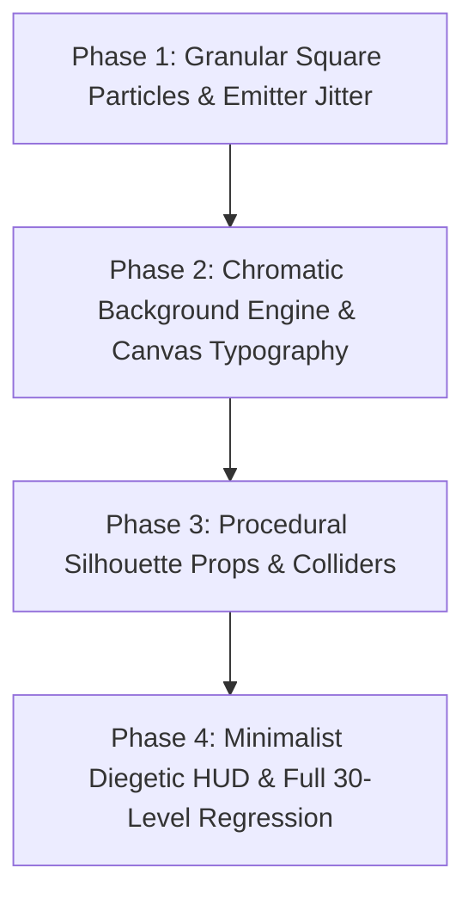

# Implementation Plan: Bart Bonte Aesthetic, Granular Square Particles & 30-Level Characteristic Architecture

> [!WARNING]
> **ARCHIVED & SUPERSEDED BY CHUNKY ARCADE**:
> While the granular square particle math, continuous collision detection, and silhouette prop colliders remain active in the headless engine, the visual presentation (chalkboard minimalism) has been superseded by the canonical **Chunky Arcade** design language (`CartoonTokens`, 3D extruded slabs, solid drop shadows, and arcade coin HUD). Refer to [docs/design/art-direction-brief.md](file:///d:/kayzz/flutter/micin/docs/design/art-direction-brief.md) and [docs/ARCHITECTURE.md](file:///d:/kayzz/flutter/micin/docs/ARCHITECTURE.md).

This Tracer Bullet Implementation Plan breaks down the engineering execution of the approved Technical Specification ([spec/spec-design-bonte-aesthetic-and-level-architecture.md](file:///d:/kayzz/flutter/micin/spec/spec-design-bonte-aesthetic-and-level-architecture.md)) into four vertical, testable, and independently verifiable phases.

Every phase delivers an end-to-end slice cutting from data models and physics to rendering and player interactions, ensuring the system remains 100% operational, fully green in automated tests, and stable at 60/120 FPS.

---

## 1. Requirements & Constraints

* **REQ-001**: Crystalline square particle batch rendering (`StrokeCap.square`, $2.2\text{ px}$) in `ParticlePainter`.
* **REQ-002**: Bounded nozzle stream horizontal micro-jitter ($\Delta v_x \in [-0.35, 0.35]\text{ px/frame}$) in `ParticleEmitter`.
* **REQ-003**: 30-Stage signature chromatic background palette engine via `LevelVisualTheme`.
* **REQ-004**: Canvas-integrated diegetic typography (`level 8`, `sugar, sugar`) rendered on the virtual canvas background plane.
* **REQ-005**: Procedural vector silhouette asset props (Teaspoons, Silhouette Hands, Teapots) with procedural rigid line colliders injected into `GameEngine`.
* **REQ-006**: Minimalist diegetic HUD with quiet circular buttons (Back `<` and Reset `⟳`).
* **REQ-007**: Cup integer countdown with $1.06\times$ scale-pulse feedback and pentatonic audio chime scaling.
* **CON-001**: Strict zero-allocation hot path invariant during active frame rendering.
* **CON-002**: Strict adherence to the $400 \times 700$ Unified Virtual Resolution coordinate space.
* **CON-003**: 100% automated test pass rate preservation (minimum 171 passed tests) with zero analyzer warnings.

---

## 2. Implementation Steps

> **EXECUTION DIRECTIVE FOR AI AGENTS:**
> You MUST execute this plan phase by phase. You MUST run the specific testing/verification task at the end of each phase. After a phase is tested, you **MUST STOP AND WAIT** for the user's explicit approval before proceeding to the next phase.

---

### Implementation Phase 1: Granular Square Particles & Stream Jitter Dynamics (MVP Tracer Bullet)

- **GOAL-001:** Transform particle visuals into crisp, pixel-sharp crystalline sugar grains with natural stream dispersal across all active screens.

| Task | Description | Ref ID | AC Ref | Dep | Files | Completed | Date |
|:---|:---|:---|:---|:---|:---|:---|:---|
| **TASK-101** | Update `ParticlePainter` to configure `Paint.strokeCap = StrokeCap.square` and `Paint.strokeWidth = 2.2` for both active falling particles and resting sand mounds. | REQ-001 | AC-001 | - | 1 | [x] | 2026-10-06 |
| **TASK-102** | Add deterministic stream horizontal micro-jitter $\Delta v_x \in [-0.35, 0.35]$ during grain spawn in `ParticleEmitter` to create natural granular curtains. | REQ-002 | AC-002 | TASK-101 | 1 | [x] | 2026-10-06 |
| **TASK-103** | Introduce crystalline micro-opacity variance ($0.88$ to $1.0$) in particle spawning to simulate natural sugar light refraction. | REQ-001 | AC-001 | TASK-102 | 1 | [x] | 2026-10-06 |
| **TASK-104** | Create unit tests in `test/painters/particle_painter_test.dart` and `test/engine/particle_emitter_test.dart` asserting square caps, particle width, and jitter bounds. | REQ-001, REQ-002 | AC-001, AC-002 | TASK-103 | 2 | [x] | 2026-10-06 |
| **TASK-105** | **VERIFY**: Run `flutter test test/painters/particle_painter_test.dart test/engine/particle_emitter_test.dart test/screens/menu_screen_test.dart` and execute `flutter analyze` to ensure 0 errors. | - | - | TASK-104 | - | [x] | 2026-10-06 |
| **TASK-106** | **APPROVAL**: Wait for explicit user confirmation to proceed to Phase 2. | - | - | TASK-105 | - | [x] | 2026-10-06 |

---

### Implementation Phase 2: Chromatic Canvas Engine & Diegetic Canvas Typography

- **GOAL-002:** Implement the 30-stage signature palette engine and embed elegant, quiet stage titles directly into the background canvas layer.

| Task | Description | Ref ID | AC Ref | Dep | Files | Completed | Date |
|:---|:---|:---|:---|:---|:---|:---|:---|
| **TASK-201** | Create `LevelVisualTheme` model mapping all 30 stages to curated background hex colors, label texts, and canvas label coordinates. | REQ-003 | AC-003 | TASK-106 | 1 | [x] | 2026-10-06 |
| **TASK-202** | Refactor `BackgroundPainter` to ingest dynamic `backgroundColor` and `canvasLabel` from `LevelVisualTheme`, rendering canvas typography with harmonized opacity ($0.18$–$0.25$). | REQ-003, REQ-004 | AC-003, AC-004 | TASK-201 | 1 | [x] | 2026-10-06 |
| **TASK-203** | Update `GameScreen` to resolve `LevelVisualTheme.forLevel(widget.levelId)` and pass the active theme to `BackgroundPainter`. | REQ-003 | AC-003 | TASK-202 | 1 | [x] | 2026-10-06 |
| **TASK-204** | Create unit and widget tests in `test/models/level_visual_theme_test.dart` and update `test/screens/game_screen_test.dart` asserting all 30 background colors and canvas typography rendering. | REQ-003, REQ-004 | AC-003, AC-004 | TASK-203 | 2 | [x] | 2026-10-06 |
| **TASK-205** | **VERIFY**: Run `flutter test test/models/level_visual_theme_test.dart test/screens/game_screen_test.dart` and execute `flutter analyze` with 0 issues. | - | - | TASK-204 | - | [x] | 2026-10-06 |
| **TASK-206** | **APPROVAL**: Wait for explicit user confirmation to proceed to Phase 3. | - | - | TASK-205 | - | [x] | 2026-10-06 |

---

### Implementation Phase 3: Procedural Silhouette Props & Collider Engine

- **GOAL-003:** Render iconic vector silhouette props (Teaspoons, Silhouette Hands, Teapots) and procedurally inject their rigid line colliders into `GameEngine`.

| Task | Description | Ref ID | AC Ref | Dep | Files | Completed | Date |
|:---|:---|:---|:---|:---|:---|:---|:---|
| **TASK-301** | Create `SilhouettePropConfig` and `SilhouetteType` enum defining transform properties (origin, scale, rotation) and shadow colors. | REQ-005 | AC-005 | TASK-206 | 1 | [x] | 2026-10-06 |
| **TASK-302** | Implement `SilhouetteColliderFactory` generating mathematical `LineSegment` colliders for Teaspoons, Double Spoons, and Silhouette Hands. | REQ-005 | AC-005 | TASK-301 | 1 | [x] | 2026-10-06 |
| **TASK-303** | Implement `SilhouettePainter` rendering procedural vector `Path`s for props directly onto the virtual canvas stack behind particles. | REQ-005 | AC-005 | TASK-302 | 1 | [x] | 2026-10-06 |
| **TASK-304** | Integrate procedural silhouette collider injection into `GameEngine` initialization, appending prop colliders to active stage obstacles. | REQ-005 | AC-005 | TASK-303 | 1 | [x] | 2026-10-06 |
| **TASK-305** | Configure signature props in `LevelVisualTheme` for Stage 5 (Teaspoon), Stage 8 (Double Spoons), and Stage 23 (Silhouette Hand). | REQ-005 | AC-005 | TASK-304 | 1 | [x] | 2026-10-06 |
| **TASK-306** | Create physics collision tests in `test/engine/silhouette_collision_test.dart` verifying that grains deflect off teaspoon contours into target cups. | REQ-005 | AC-005 | TASK-305 | 1 | [x] | 2026-10-06 |
| **TASK-307** | **VERIFY**: Run `flutter test test/engine/silhouette_collision_test.dart test/screens/game_screen_test.dart` and `flutter analyze`. | - | - | TASK-306 | - | [x] | 2026-10-06 |
| **TASK-308** | **APPROVAL**: Wait for explicit user confirmation to proceed to Phase 4. | - | - | TASK-307 | - | [x] | 2026-10-06 |

---

### Implementation Phase 4: Minimalist Diegetic HUD, ASMR Polish & Full 30-Level Regression

- **GOAL-004:** Streamline in-game controls into quiet, minimal icons, add cup integer pulse animations, and verify 100% test regression suite.

| Task | Description | Ref ID | AC Ref | Dep | Files | Completed | Date |
|:---|:---|:---|:---|:---|:---|:---|:---|
| **TASK-401** | Streamline `GameHud` into quiet, minimal circular buttons for Back (`<`) and Reset (`⟳`), preserving existing keys and touch semantics. | REQ-006 | AC-006 | TASK-308 | 1 | [x] | 2026-10-06 |
| **TASK-402** | Add $80$ms subtle scale-pulse ($1.00 \rightarrow 1.06 \rightarrow 1.00$) to cup countdown numerals in `LevelPainter` upon grain capture. | REQ-007 | AC-007 | TASK-401 | 1 | [x] | 2026-10-06 |
| **TASK-403** | Calibrate pentatonic audio chime pitch scaling in `AudioManager` to escalate smoothly as cups approach zero remaining. | GUD-001 | AC-007 | TASK-402 | 1 | [x] | 2026-10-06 |
| **TASK-404** | Execute full test suite regression (`flutter test`) verifying all 171+ unit, widget, and integration tests pass with 0 failures. | CON-003 | AC-006 | TASK-403 | - | [x] | 2026-10-06 |
| **TASK-405** | Update canonical architecture map `docs/ARCHITECTURE.md` and domain glossary `CONTEXT.md` with completed Bart Bonte systems. | - | - | TASK-404 | 2 | [x] | 2026-10-06 |
| **TASK-406** | **VERIFY**: Run `flutter analyze` and `flutter test` across the entire workspace. | CON-003 | AC-006 | TASK-405 | - | [x] | 2026-10-06 |
| **TASK-407** | **APPROVAL**: Final presentation and sign-off for milestone completion. | - | - | TASK-406 | - | [x] | 2026-10-06 |

---

## 3. Alternatives

* **ALT-001 (SVG Files via `flutter_svg`):** Rejected. Loading external `.svg` files introduces asynchronous I/O disk reads, external package dependencies, and manual collider alignment hurdles. Procedural vector `Path`s deliver instant 120 FPS frame starts with 100% mathematical collider alignment.
* **ALT-002 (Static Collider Baking in JSON Files):** Rejected. Hardcoding coordinates into 30 JSON files increases maintenance overhead and risks visual-collider desync. Procedural injection via `LevelVisualTheme` guarantees zero desync.
* **ALT-003 (Soft Circular Particles):** Rejected. Bart Bonte's authentic aesthetic relies on distinct crystalline square grains (`StrokeCap.square`), delivering a tactile, crunchy, and authentic sugar feel.

---

## 4. Dependencies

* **Framework:** Flutter SDK `>=3.44.8` (Dart `>=3.12.2`).
* **Libraries:** `flutter_riverpod: ^2.6.1`, `audioplayers: ^6.1.0`.
* **Zero New Third-Party Dependencies:** Implemented strictly using Flutter's native `dart:ui` and `Canvas` APIs.

---

## 5. Files Affected

* `micin_micin/lib/screens/game/painters/particle_painter.dart` (Square particle batching)
* `micin_micin/lib/engine/particle_emitter.dart` (Spawn stream horizontal micro-jitter)
* `micin_micin/lib/models/level_visual_theme.dart` (New model: 30-stage signature palette & props)
* `micin_micin/lib/models/silhouette_prop_config.dart` (New model: Vector prop configuration)
* `micin_micin/lib/engine/collision/silhouette_collider_factory.dart` (New factory: Procedural line colliders)
* `micin_micin/lib/screens/game/painters/silhouette_painter.dart` (New painter: Procedural vector prop shadows)
* `micin_micin/lib/screens/game/painters/background_painter.dart` (Dynamic palette & canvas typography)
* `micin_micin/lib/screens/game/game_hud.dart` (Minimalist diegetic circular controls)
* `micin_micin/lib/screens/game/painters/level_painter.dart` (Cup integer countdown scale pulse)
* `micin_micin/lib/screens/game/game_screen.dart` (Theme injection & silhouette layer integration)
* `docs/ARCHITECTURE.md` (Living architecture map updates)
* `CONTEXT.md` (Domain glossary updates)

---

## 6. Testing Strategy

* **Unit Tests:**
  - `particle_painter_test.dart`: Point batching with `StrokeCap.square` and settled sand mounds.
  - `particle_emitter_test.dart`: Deterministic horizontal velocity jitter bounds ($\Delta v_x \in [-0.35, 0.35]$).
  - `level_visual_theme_test.dart`: Resolution of all 30 stages to verified signature background colors.
  - `silhouette_collision_test.dart`: Continuous raycasting deflection off teaspoon and hand colliders.
* **Widget & Integration Tests:**
  - `game_screen_test.dart`: Canvas typography rendering, minimal HUD button taps, and pause/reset transitions.
  - `navigation_test.dart`: Full navigation flow from Menu to Game to Level Select.
* **Full Regression:** 100% green pass rate across all 171+ automated tests in `test/`.

---

## 7. Risks & Assumptions

* **RISK-001 (PointMode.points Square Rendering on Older Devices):** On legacy OpenGL drivers, `StrokeCap.square` point rendering may behave differently.
  - *Mitigation:* Impeller on iOS/Android handles `StrokeCap.square` as native quads. Unit tests verify consistent pixel drawing.
* **RISK-002 (Visual-Collider Misalignment on Complex Silhouette Curves):** Complex silhouette props could have gaps between visual art and physics colliders.
  - *Mitigation:* `SilhouetteColliderFactory` and `SilhouettePainter` share the exact same mathematical bezier control points.
* **ASSUMPTION-001:** Excess grains that miss cups and fall past $y = 700$ are recycled into the pool, preserving zero-GC performance.
* **ASSUMPTION-002:** All 30 existing level JSON files can be played with their new chromatic backgrounds without modifying JSON geometry.

---

## 8. Related Specifications & Upstream Documents

* [Technical Spec: Bart Bonte Aesthetic, Granular Square Particles & 30-Level Characteristic Architecture](file:///d:/kayzz/flutter/micin/spec/spec-design-bonte-aesthetic-and-level-architecture.md)
* [Game Design Document](file:///d:/kayzz/flutter/micin/docs/gdd/GDD-bonte-aesthetic-and-level-design.md)
* [Clarification Report (Score 100/100)](file:///d:/kayzz/flutter/micin/docs/audit/clarification-report-bonte-aesthetic-and-level-architecture-2026-10-06.md)
* [Living Architecture Map](file:///d:/kayzz/flutter/micin/docs/ARCHITECTURE.md)

---

## 9. Rollback / Recovery Plan

If any phase introduces critical regressions or test failures:
1. Revert surgical commits using `git checkout` on the affected component files.
2. In `ParticlePainter`, restore `StrokeCap.round` and static `GlassTokens.obsidianVoid` background.
3. In `GameEngine`, disable `theme.silhouetteProps` collider injection.
4. Execute `flutter test` to ensure full restoration of the stable 171-test baseline.
