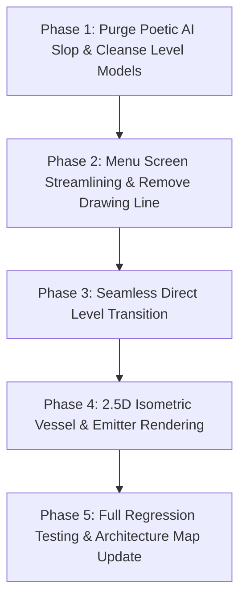

# Implementation Plan: 2.5D Isometric Visuals, Seamless Level Advance & Anti-Slop Layout Overhaul

> [!WARNING]
> **ARCHIVED & SUPERSEDED BY CHUNKY ARCADE**:
> While direct stage flow, anti-slop copy rules, and the headless physics engine remain active, the 2.5D visual styling has been consolidated and superseded by the canonical **Chunky Arcade** design language (`CartoonTokens`, 3D extruded slabs, solid drop shadows, and arcade coin HUD). Refer to [docs/design/art-direction-brief.md](file:///d:/kayzz/flutter/micin/docs/design/art-direction-brief.md) and [docs/ARCHITECTURE.md](file:///d:/kayzz/flutter/micin/docs/ARCHITECTURE.md).

This implementation plan breaks down the approved technical specification ([spec/spec-sugar-sugar-2.5d-isometric-and-bonte-overhaul.md](file:///d:/kayzz/flutter/micin/spec/spec-sugar-sugar-2.5d-isometric-and-bonte-overhaul.md)) into five vertical, testable, and independently verifiable phases.

---

## 1. Requirements & Acceptance Criteria Traceability

* **REQ-001**: 2.5D Isometric Cup and Nozzle rendering in `LevelPainter`.
* **REQ-002**: Removal of `LineController` and drawing gestures from `MenuScreen`.
* **REQ-003**: Direct automated 1000ms transition to the next level in `GameScreen` upon completion; removal of `LevelCompleteDialog`.
* **REQ-004**: Complete removal of "EQUILIBRIUM", "KABUT FAJAR", and poetic zen meditation copy.
* **REQ-005**: 100% green pass rate across all automated tests with 0 analyzer issues.

---

## 2. Implementation Phases

### Phase 1: Purge Poetic AI Slop & Cleanse Level Models
* **TASK-101**: Refactor `micin_micin/lib/models/level_ambiance.dart` to remove all instances of `zenReflection`, `actTitle`, and poetic themes like `Kabut Fajar`. Standardize stage naming to clean `Level X`.
* **TASK-102**: Cleanse any remaining poetic strings across `micin_micin/lib/models/level_visual_theme.dart` and UI strings.
* **TASK-103**: Update corresponding model unit tests in `test/models/level_ambiance_test.dart` and `test/models/level_visual_theme_test.dart`.
* **TASK-104**: Verify with `flutter test test/models/` and `flutter analyze`.

### Phase 2: Menu Screen Streamlining & Remove Interactive Line
* **TASK-201**: Refactor `micin_micin/lib/screens/menu/menu_screen.dart` to remove `LineController`, touch drag detectors for freehand drawing, and the `CLEAR` button.
* **TASK-202**: Maintain smooth decorative sugar sand cascade animation while preventing any touch interception.
* **TASK-203**: Update `test/screens/menu_screen_test.dart` to assert that drawing gestures do not register and `CLEAR` button is absent.
* **TASK-204**: Verify with `flutter test test/screens/menu_screen_test.dart`.

### Phase 3: Seamless Direct Level Transition (Remove Dialog)
* **TASK-301**: Update `micin_micin/lib/screens/game/game_screen.dart` to eliminate `LevelCompleteDialog` overlay.
* **TASK-302**: Implement automated non-blocking 1000ms transition logic in `game_screen.dart` (`_handleLevelCompletion`) that advances directly to `/game/${levelId + 1}` (or `/levels` for stage 30).
* **TASK-303**: Update `test/screens/game_screen_test.dart` and `test/screens/level_complete_dialog_test.dart` to match direct transition semantics.
* **TASK-304**: Verify with `flutter test test/screens/game_screen_test.dart`.

### Phase 4: 2.5D Isometric Vessel & Emitter Rendering
* **TASK-401**: Update `LevelPainter._renderCups` to render 2.5D isometric geometry: elliptical opening rim, dimensional shaded body walls, and grounded drop shadow oval.
* **TASK-402**: Update `LevelPainter._renderEmitters` to render 2.5D isometric funnel nozzles with elliptical downward apertures.
* **TASK-403**: Verify internal 2D physics hitboxes (`CupHitbox`) retain exact 100% mathematical alignment.
* **TASK-404**: Update painter tests in `test/painters/level_painter_test.dart`.

### Phase 5: Full Regression Testing & Architecture Map Update
* **TASK-501**: Run full regression test suite `flutter test` across all 189+ tests.
* **TASK-502**: Run `flutter analyze` to guarantee zero warnings or linter violations.
* **TASK-503**: Update `docs/ARCHITECTURE.md` and `instructions/memory.instructions.md`.
